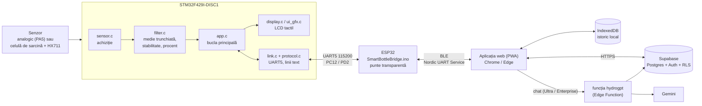

# Documentația codului Smart Bottle

Documentație tehnică pentru cine citește sau modifică codul: echipa, profesorul coordonator și un viitor
întreținător care știe C și JavaScript, dar nu cunoaște proiectul. Ghidul de utilizare (cablaj, instalare,
calibrare din aplicație) e în [`../README.md`](../README.md); aici e descris **cum funcționează codul**.

| Document | Ce acoperă |
|---|---|
| [Firmware STM32](firmware-stm32.md) | Placa STM32F429I-DISC1: achiziție, filtrare, protocol, UART, interfața LCD tactilă, build (make, Keil, CubeIDE) |
| [Puntea ESP32](punte-esp32.md) | Adaptorul UART ↔ BLE, heartbeat, istoricul nivelului, modul simulat, fluxul mesajelor cap-coadă |
| [Aplicația web](aplicatia-web.md) | PWA-ul: conexiunea Web Bluetooth, conversia în mL, detecția înghițiturilor, IndexedDB, grafice, sincronizarea LCD-ului |
| [Module web și cloud](module-web-si-cloud.md) | Agentul HydroGPT, abonamente, obiceiuri, reclame, autentificare, sincronizare Supabase, funcția `hydrogpt`, schema bazei de date |
| [Protocolul](../PROTOCOL.md) | Formatul fiecărui mesaj text dintre STM32, ESP32 și aplicație (sursa de adevăr pentru protocol) |
| [Lista de componente](../BOM.md) | Hardware-ul necesar |

## Arhitectura sistemului

Placa STM32 e singura care atinge senzorul; ESP32 doar retransmite liniile (generează însă singur câteva
mesaje: `S`, `H`, `P`, `G`). Aplicația web face toată logica „de business”: mL, evenimente de consum,
obiective, istoric, cont și agent.

## Cine calculează ce

| Mărime / decizie | Unde se calculează | Unde se folosește |
|---|---|---|
| Valoarea brută filtrată (`raw`) | STM32, `sensor.c` (15 eșantioane, medie trunchiată, la 1 s) | LCD, mesajul `L`, aplicație |
| Stabilitatea (`stable`) | STM32, `filter.c` (ultimele 5 citiri, max − min ≤ prag) | mesajul `L`; aplicația ia în calcul doar citirile stabile pentru consum |
| Procentul de umplere (`pct`) | STM32, `level_percent()`, cu calibrarea primită de la aplicație | desenul sticlei pe LCD, mesajul `L`, graficul `G` |
| Calibrarea (gol / plin) | aplicația (sursa de adevăr, în `localStorage`); STM32 o ține doar în RAM | aplicația o trimite (`C`) la fiecare conectare; meniul LCD o poate schimba (`K`) |
| Volumul în mL | aplicația, `mlFromRaw()` (calibrare + capacitate + forma sticlei) | ecranul aplicației; LCD-ul primește valoarea afișată prin `M` |
| Înghițituri și reumpleri | aplicația, `EventDetector` | IndexedDB, Supabase, statistici trimise LCD-ului (`T`, `U`, `W`) |
| Istoricul nivelului pe 10 min | ESP32 (60 de puncte × 10 s, în RAM) | graficul de pe LCD (`G`) |
| Starea legăturii | ESP32 (`H` la 2 s spre STM32, răspuns `P` la ping-ul aplicației) | LED-ul verde și ecranul de stare de pe LCD; indicatorul din aplicație |
| Abonamentul, clasamentul | Supabase (`profiles`, `checkout()`, `leaderboard_today()`) | aplicația; funcția `hydrogpt` refuză Free / Pro |

## Unde stă starea

| Date | Locație | Persistență |
|---|---|---|
| Setări și calibrare | browser, `localStorage['sb.settings']` | permanentă pe dispozitivul utilizatorului |
| Citiri și evenimente | browser, IndexedDB `smartbottle` (`readings`, `events`) | permanentă local; evenimentele se urcă în Supabase |
| Istoric multi-dispozitiv, profil, facturi | Supabase (`drink_events`, `profiles`, `invoices`) | permanentă, protejată de RLS |
| Calibrare și statistici pe placă | RAM STM32 (`ui_state_t` din `app.c`) | se pierde la reset; aplicația le retrimite |
| Istoricul nivelului pe 10 min | RAM ESP32 | se pierde la repornirea ESP32 |

## Structura repo-ului

| Cale | Conținut |
|---|---|
| `stm32/` | Firmware-ul (codul propriu în `Core/`, `Makefile`, script de link, startup GCC, `tools/`) |
| `stm32/Drivers/`, `stm32/Utilities/` | Driverele ST (HAL, CMSIS, BSP, fonturi); nu sunt în git, le descarcă `stm32/tools/fetch_deps.py` |
| `stm32-keil/` | Proiectul Keil µVision (doar proiectul și startup-ul armasm; sursele vin din `stm32/`) |
| `stm32-cubeide/` | Proiectul STM32CubeIDE (doar `.project` / `.cproject`; sursele sunt legate din `stm32/`) |
| `esp32/SmartBottleBridge/` | Sketch-ul Arduino al punții și placa STM32 simulată (`MockStm32.h`) |
| `web/` | Aplicația web, fișiere statice fără pas de build |
| `supabase/` | Migrările SQL și funcția Edge `hydrogpt` |
| `tests/` | Teste pe PC: C pentru codul pur al firmware-ului, Node pentru logica aplicației |
| `docs/` | Această documentație |

## Build, scriere pe placă și publicare

| Componentă | Unelte | Detalii |
|---|---|---|
| STM32 | `make` + `arm-none-eabi-gcc` + OpenOCD, sau Keil µVision, sau STM32CubeIDE | [firmware-stm32.md](firmware-stm32.md), [`../README.md`](../README.md) |
| ESP32 | Arduino IDE, placa *ESP32 Dev Module* | [punte-esp32.md](punte-esp32.md) |
| Aplicația web | niciun build; local cu `python -m http.server`, online prin Vercel la fiecare push pe `main` | [aplicatia-web.md](aplicatia-web.md) |
| Supabase | migrările din `supabase/migrations/` în ordine, `supabase functions deploy hydrogpt` | [module-web-si-cloud.md](module-web-si-cloud.md) |

## Teste

Toate rulează pe PC, fără hardware. Comenzile se dau din `tests/`:

| Fișier | Ce verifică | Comandă |
|---|---|---|
| `test_host.c` | `filter.c` (medie trunchiată, stabilitate, procent) și `protocol.c` (parsare, formatare, asamblarea liniilor) | `gcc -Wall -Wextra -I../stm32/Core/Inc test_host.c ../stm32/Core/Src/filter.c ../stm32/Core/Src/protocol.c -o t && ./t` |
| `test_logic.mjs` | `web/logic.js`: conversii, detecția evenimentelor, mesajele către LCD | `node test_logic.mjs` |
| `test_link.mjs` | `LinkMonitor` (heartbeat și reconectare) | `node test_link.mjs` |
| `test_agent.mjs` | agentul HydroGPT și abonamentele (`web/agent.js`) | `node test_agent.mjs` |
| `test_insights.mjs` | analiza obiceiurilor și identitatea copiei din funcția Supabase | `node test_insights.mjs` |

Detaliile fiecărui test sunt în documentul zonei respective.

## Convenții

- Comentariile din cod sunt în română, la fel ca documentația și mesajele de commit.
- Codul firmware care nu depinde de HAL (`filter.c`, `protocol.c`) e scris ca să poată fi testat pe PC.
- Driverele ST nu intră în git; versiunile sunt fixate pe commit-uri în `stm32/tools/fetch_deps.py`.
- Orice modificare în `web/` crește versiunea cache-ului din `web/sw.js` (`smartbottle-vN`), altfel
  telefoanele cu aplicația instalată rămân pe fișierele vechi.
- Protocolul se schimbă la toate capetele odată: `PROTOCOL.md`, `stm32/Core/Src/protocol.c` (+ `app.c`),
  `web/logic.js` / `web/app.js` și, dacă e cazul, `esp32/` și testele.

## Glosar

| Termen | Sens în proiect |
|---|---|
| *raw* / brut | Valoarea filtrată a senzorului: ADC 0–4095 sau valoare HX711 cu semn |
| calibrare gol / plin | Valorile *raw* cu recipientul gol și plin; definesc 0 % și 100 % |
| stabil | Ultimele 5 citiri diferă cu cel mult pragul (15 unități ADC, 2000 HX711) |
| înghițitură / reumplere | Eveniment detectat de aplicație din scăderea / creșterea volumului între citiri stabile |
| sticlă absentă | Citire sub calibrarea „gol” cu peste 5 % din domeniu (sticla ridicată de pe cântar) |
| mock / simulat | Senzor sau placă STM32 înlocuite cu un model software (pe ESP32, pe STM32 sau butonul Demo din aplicație) |
| VCP | Portul serial virtual al ST-LINK (USART1); build-ul `LINK=vcp` mută protocolul pe el |
| NUS | Nordic UART Service, serviciul BLE folosit ca „port serial” wireless |
| PWA | Aplicație web instalabilă, cu funcționare offline prin service worker |
| RLS | Row Level Security în Postgres: fiecare utilizator vede doar rândurile lui |
| abonament (*tier*) | Free / Pro / Ultra / Enterprise; schimbă precizia afișajului, accesul la agent și reclamele |
