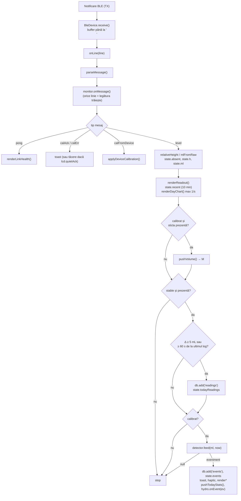
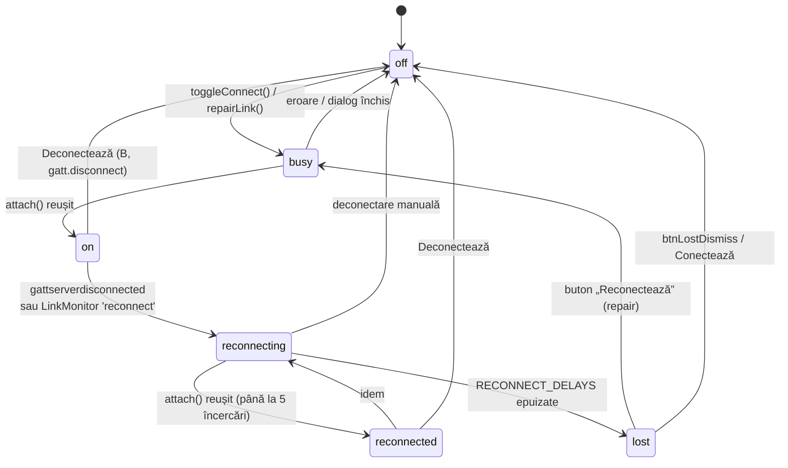
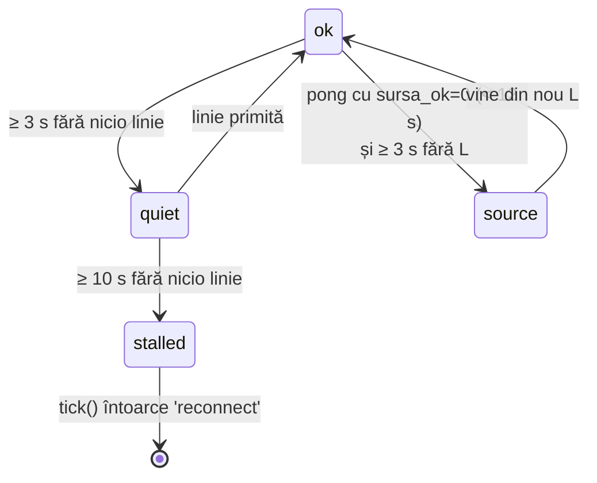
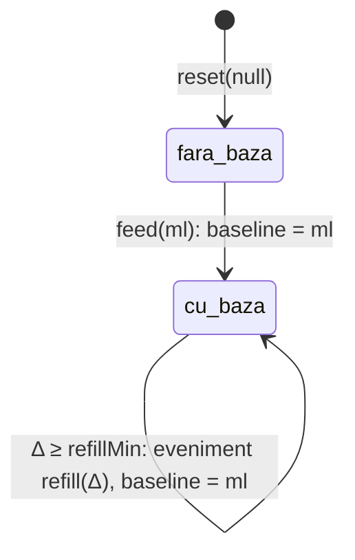

# Aplicația web (PWA)

Înapoi la [index](README.md) · protocol: [../PROTOCOL.md](../PROTOCOL.md) · firmware: [firmware-stm32.md](firmware-stm32.md) · punte BLE: [punte-esp32.md](punte-esp32.md) · agent, abonamente, cloud: [module-web-si-cloud.md](module-web-si-cloud.md)

## 1. Rol și context

Aplicația din `web/` e capătul utilizatorului: se conectează prin Web Bluetooth la ESP32 (Nordic UART Service), primește citirile `L,...` venite de la STM32, le transformă în mililitri pe baza calibrării, detectează înghițiturile și reumplerile, le salvează în IndexedDB și le trimite înapoi plăcii ca statistici pentru meniul de pe LCD. E un site static, fără build (module ES încărcate direct de browser), instalabil ca PWA și publicat pe Vercel. Partea de cont, sincronizare Supabase, agent HydroGPT, abonamente și reclame stă în module separate, descrise în [module-web-si-cloud.md](module-web-si-cloud.md); aici apare doar granița lor cu `app.js`.

## 2. Structura fișierelor

| Fișier | Responsabilitate |
|---|---|
| `web/index.html` | Toată structura paginii: bara de sus, ecranul de autentificare, anunțuri, cardurile, bara de secțiuni, dialogurile (`<dialog class="sheet">`), sprite-ul de iconițe Lucide |
| `web/app.js` | Punctul de intrare: setări, IndexedDB, transportul BLE (`BleDevice`), simulatorul (`DemoDevice`), procesarea mesajelor, calibrare, grafice, statistici pentru LCD, heartbeat, memento, pornire (`init()`) |
| `web/logic.js` | Logică pură, fără DOM, testată în Node: conversia raw → mL, forme de sticlă, parsarea mesajelor, `EventDetector`, `LinkMonitor`, liniile `C`/`M`/`T`/`U`/`W` |
| `web/mobile.js` | Comportament pe telefon: mutarea butoanelor de conectare, bara de secțiuni, Screen Wake Lock, vibrații, reverificare la revenirea în prim-plan |
| `web/style.css` | Sistemul de design neumorfic (doar temă luminoasă), grila, variantele pentru telefon, stilurile reclamelor |
| `web/sw.js` | Service worker: cache pentru offline, strategie „rețea întâi” |
| `web/manifest.webmanifest` | Manifestul PWA (nume, iconițe, scurtătura „Demo”) |
| `web/config.js` | `SUPABASE_URL` și `SUPABASE_KEY` (cheie „publishable”); folosit de modulele cloud |
| `vercel.json` (rădăcina repo-ului) | Rescrieri care servesc `smart-bottle/web/` la rădăcina site-ului, `no-cache` pentru `sw.js` |
| `tests/test_logic.mjs` | Teste pentru conversie, parsare, detector, totaluri zilnice, liniile pentru LCD |
| `tests/test_link.mjs` | Teste pentru `LinkMonitor` (heartbeat) |
| `web/agent.js`, `hydro.js`, `auth.js`, `cloud.js`, `ads.js`, `habits.js`, `insights.js` | Vezi [module-web-si-cloud.md](module-web-si-cloud.md) |
| `web/icon*.png`, `icon.svg`, `apple-touch-icon.png` | Iconițele aplicației |

## 3. Arhitectură / flux

### 3.1 Pornirea (`app.js` → `init()`)

1. Arată bannerul `#unsupported` dacă lipsește `navigator.bluetooth` (și nu a fost ascuns, cheia `sb.hideUnsupported`).
2. `bindSettings()`, `renderSettings()`, `setBottleShape()`, `renderReadout()`, pornește animația sticlei (`watchBottle()`, `startAnim()`).
3. Leagă butoanele `btnConnect`, `btnDemo`, `btnRepair`, `btnLostDismiss`; expune `window.smartBottleDebug`.
4. `db.open()`, șterge citirile mai vechi de 30 de zile, încarcă citirile de azi și evenimentele din ultimele 8 zile (azi + 7), calculează `state.lastDrinkTs`.
5. Desenează cardurile, pornește `checkReminder` la 30 s și un `ResizeObserver` pentru grafice.
6. `await authGate()` (ecranul de intrare), apoi `initHydro({...})`.
7. Dacă URL-ul are `?demo`, pornește demo-ul; `closeSheetsOnOutsideClick()`; `initMobile({...})`; înregistrează `sw.js` doar în context securizat.

### 3.2 Fluxul unei citiri



### 3.3 Starea conexiunii

`onState(s)` primește una din stările de mai jos de la `BleDevice` sau `DemoDevice`:



La `on`/`reconnected`: `detector.reset(null)`, se trimit `C,gol,plin` și `R`, `lcd.lastMl = null`, `pushTodayStats({ week: true })`, pornesc timerul `U` și heartbeat-ul, `keepAwake(true)`, iar la `reconnected` apare toast-ul „Reconectat”. La orice altă stare finală (`off`, `lost`): se opresc heartbeat-ul și timerul LCD, `keepAwake(false)`, `state.link = null` (la `lost` legătura se păstrează în `state.lostLink` pentru butonul „Reconectează”), memento-ul se ascunde. În ambele cazuri se apelează `hydro.onConnectionChange()`.

### 3.4 Heartbeat (`LinkMonitor`)



`heartbeat()` rulează la 1 s cât timp e conectat și nu se reconectează: `monitor.tick(now)` → `'ping'` trimite `P\n`; `'reconnect'` afișează toast, `monitor.reset(now)` și `state.link.forceReconnect()`. Pilula `#connState` arată `Conectat`/`Demo` (ok), `Semnal slab` (quiet, stalled), `Fără date` (source; în plus bannerul `#sourceStall`); `title` conține vechimea ultimului mesaj și latența (`monitor.rtt`).

### 3.5 Detecția înghițiturilor (`EventDetector`)



## 4. Module în detaliu

### 4.1 `web/logic.js`

Modul fără DOM și fără Bluetooth, importabil în Node.

| Export | Semnătură / valoare | Efect |
|---|---|---|
| `SHAPES` | `{ cylinder, cone, neck }` → etichete românești | Opțiunile din `<select id="shape">` |
| `volumeFraction(shape, h)` | `h` tăiat la [0,1] → fracție de volum [0,1] | Vezi mai jos |
| `relativeHeight(raw, cal)` | `(raw − empty)/(full − empty)`, **netăiat**; 0 dacă `full === empty` | Funcționează și cu calibrare inversată (`empty > full`) |
| `ABSENT_BELOW` | `-0.05` | Sub această înălțime relativă sticla e considerată ridicată/absentă |
| `mlFromRaw(raw, cal)` | `round(capacity · volumeFraction(shape, relativeHeight))` | mL în [0, capacity] |
| `levelColor(pct)` | `≥50 → 'ok'`, `≥20 → 'mid'`, altfel `'low'` | Culoarea lichidului (`data-level` pe SVG) |
| `parseMessage(line)` | linie → `{type,...}` sau `null` | Vezi tabelul de tipuri |
| `EventDetector` | `new EventDetector({ drinkMin=30, refillMin=50 })`, `reset(ml=null)`, `feed(ml, ts)` | Detecția evenimentelor |
| `dayKey(ts)` | `"YYYY-MM-DD"` în ora locală | Cheie de zi |
| `dailyTotals(events, days, now)` | `[{ day, ml }]`, cea mai veche prima | Suma `drink` pe zi; referința e la ora 12:00 ca să nu sară zile la schimbarea orei |
| `calibrationCommand(cal)` | `"C,<round(empty)>,<round(full)>\n"` | |
| `volumeLine(ml, cap)`, `todayLine(total, goal, n)`, `sinceLine(min)`, `weekLine(i, ml)` | linii `M`, `T`, `U`, `W` | Numere limitate (`STAT_MAX = 99999`, număr înghițituri ≤ 999, `i` în 0..6) ca fiecare linie să încapă în 20 de octeți; `sinceLine` dă `-1` pentru `null`/`undefined`/negativ; valorile ne-finite devin minimul |
| `HEARTBEAT` | constante, vezi Configurare | |
| `LinkMonitor` | `new LinkMonitor(opts, now)`, `reset(now)`, `onMessage(msg, now)`, `health(now)`, `tick(now)` | Supravegherea legăturii |

**Tipurile din `parseMessage`** (formatul exact e în [../PROTOCOL.md](../PROTOCOL.md)):

| Intrare | Rezultat | Validare |
|---|---|---|
| `L,raw,pct,stable` | `{ type:'level', raw, pct, stable: stable===1 }` | exact 4 câmpuri, toate numerice |
| `P,uptime,ok` | `{ type:'pong', uptime, sourceOk: ok===1 }` | exact 3 câmpuri numerice |
| `K,gol,plin` | `{ type:'calFromDevice', empty, full }` | exact 3 câmpuri, întregi cu semn opțional (`/^-?\d+$/`): `K,1.5,2` și `K,,2` sunt respinse |
| `A,C` / `E,C` | `{ type:'calAck' }` / `{ type:'calErr' }` | potrivire exactă după `trim()` |
| orice altceva, linie goală | `null` | |

**Formele de sticlă (`volumeFraction`).** Senzorul dă înălțimea; volumul depinde de cât de lată e sticla la fiecare înălțime.

| `shape` | Model | Formula |
|---|---|---|
| `cylinder` (implicit) | secțiune constantă | `V = h` |
| `cone` | rază 0,6 jos → 1,0 sus, aria ∝ (a + b·y)², a=0,6, b=0,4 | `V = I(h)/I(1)`, `I(y) = ((a+b·y)³ − a³)/(3b)` |
| `neck` | corp cilindric până la 75 %, gât cu rază 0,45 (arie 0,2025) | `v = h` pentru `h ≤ 0,75`, altfel `0,75 + (h−0,75)·0,2025`; `V = v / (0,75 + 0,25·0,2025)` |

Toate dau 0 la `h=0`, 1 la `h=1` și sunt monotone (verificat în teste).

**`EventDetector.feed(ml, ts)`.** Prima valoare devine linia de bază. Linia de bază se mută **doar** la un eveniment, deci sorbiturile mici se adună până trec pragul (700 → 690 → 675 nu produce nimic; 660 produce `drink 40`), iar zgomotul nu produce nimic. `delta ≤ −drinkMin` → `{ type:'drink', ml: −delta, ts }`; `delta ≥ refillMin` → `{ type:'refill', ml: delta, ts }`. Apelantul îi dă doar citiri stabile, cu sticla prezentă și calibrare validă.

**`LinkMonitor`.** Logică pură: primește timpul, întoarce ce e de făcut.
- `onMessage(msg, now)`: actualizează `lastRx` pentru orice linie (și pentru `msg === null`, adică linie neînțeleasă); `lastData` doar pentru `level`; la `pong` calculează `rtt` dacă era un ping în zbor și incrementează `reboots` dacă `uptime` a scăzut (ESP32 a repornit).
- `health(now)`: `stalled` dacă liniștea ≥ `stallAfter`; `quiet` dacă ≥ `quietAfter`; `source` dacă ultimul pong (mai nou de `sourceStale`) spunea `sourceOk=false` și nu a venit `L` de `quietAfter`; altfel `ok`. Starea `source` nu declanșează reconectare: Bluetooth-ul e bun, placa STM32 tace.
- `tick(now)`: `stalled` → `stalls++` și `'reconnect'`; altfel `'ping'` dacă (`quiet` și au trecut `pingGap`) sau au trecut `pingEvery` de la ultimul ping.
- `reboots` și `stalls` sunt pe toată sesiunea; `reset()` nu le șterge.

### 4.2 `web/app.js`

#### Setări (`cfg`) și persistență

`cfg = { ...DEFAULTS, ...JSON.parse(localStorage['sb.settings']) }`; `saveSettings()` scrie tot obiectul înapoi (dacă `localStorage` nu merge, setările rămân doar în memorie). `cfg` e pasat și lui `initHydro`, care scrie în el `tier` (și obiectivul, prin `syncGoal`).

| Câmp | Implicit | Semnificație |
|---|---|---|
| `empty`, `full` | `0`, `3000` | Valori brute pentru gol / plin |
| `calibratedEmpty`, `calibratedFull` | `false` | Fiecare capăt a fost setat |
| `calibrated` | `false` | `empty !== full && calibratedEmpty && calibratedFull` (calculat în `applyCalibration()`) |
| `capacity` | `750` | mL; input 50–5000 |
| `shape` | `'cylinder'` | cheie din `SHAPES` |
| `goal` | `2000` | obiectiv zilnic; input 250–6000 |
| `drinkMin` | `30` | prag înghițitură (mL); input 10–300; actualizează direct `detector.drinkMin` |
| `remindHours` | `2` | ore fără apă până la memento; input 0,5–12 |
| `notify` | `false` | notificări de sistem (cere permisiunea la bifare) |
| `wakeLock` | `true` | ține ecranul aprins cât e conectată sticla |
| `tier` | `'free'` | abonamentul (gestionat de `hydro.js`) |

| Cheie `localStorage` | Conținut |
|---|---|
| `sb.settings` | JSON-ul `cfg` |
| `sb.hideUnsupported` | `'1'` după ce utilizatorul a închis bannerul „Bluetooth-ul web merge doar în Chrome sau Edge” |

Alte chei pot fi folosite de modulele cloud; vezi [module-web-si-cloud.md](module-web-si-cloud.md).

Validarea câmpurilor numerice (`num(id, key, min, max)` în `bindSettings()`): o valoare ne-finită sau în afara intervalului e respinsă și inputul revine la valoarea veche. Efecte secundare: `capacity` → `detector.reset(null)` și `lcd.lastMl = null`; `goal` → `syncGoal(v)` + `pushTodayStats()`; apoi se redesenează `renderToday/WeekChart/DayChart/Readout`. Schimbarea formei resetează și ea detectorul.

#### Starea de rulare (`state`)

| Câmp | Semnificație |
|---|---|
| `link` | `BleDevice` sau `DemoDevice` curent, `null` când e deconectat |
| `connected`, `reconnecting` | starea legăturii (setată în `onState`) |
| `lostLink` | legătura păstrată după `lost`, pentru `repairLink()` |
| `raw`, `ml`, `h`, `stable`, `absent` | ultima citire: brut, mL, înălțime tăiată la [0,1], stabilă, sticlă absentă |
| `lastLogged` | `{ ts, raw, ml }`, ultima citire salvată în IndexedDB |
| `todayReadings` | `{ ts, ml }` salvate azi (pentru grafic, după reîncărcare) |
| `recent` | `{ ts, ml }` fiecare citire cu sticla prezentă din ultimele 10 min |
| `chartAt` | momentul ultimei redesenări a graficului (limitare la 1/s) |
| `events` | evenimentele din ultimele 8 zile (+ cele noi și cele aduse din cloud) |
| `lastDrinkTs` | momentul ultimei înghițituri |
| `connectedSince` | începutul conexiunii (referință pentru memento dacă nu s-a băut) |
| `reminded` | memento-ul a fost deja arătat de la ultima înghițitură |

`state` e pasat și lui `initHydro`, care îl citește.

#### IndexedDB (`db`)

Baza `smartbottle`, versiunea 1. Ambele magazine au `keyPath: 'id'`, `autoIncrement` și index `ts`.

| Magazin | Înregistrare | Când se scrie | Retenție |
|---|---|---|---|
| `readings` | `{ id, ts, raw, ml }` | citire stabilă, sticla prezentă, Δ ≥ 5 mL față de ultima salvată sau ≥ 60 s de la ea (și fără calibrare) | `deleteBefore('readings', now − 30 zile)` la pornire |
| `events` | `{ id, type: 'drink'\|'refill', ml, ts }` | la fiecare eveniment detectat și în `mergeCloudEvents()` | nelimitată (se șterge doar cu „Șterge istoricul”) |

Metode: `open()`, `add(store, obj)`, `since(store, ts)` (cursor pe index, `ts ≥`), `deleteBefore(store, ts)` (`ts <`), `clear()`. Toate rezolvă promisiunea și la eroare; fără IndexedDB (`handle === null`) devin no-op și istoricul rămâne doar în memorie.

#### `BleDevice` (Web Bluetooth)

| Constantă | Valoare |
|---|---|
| `NUS_SERVICE` | `6e400001-b5a3-f393-e0a9-e50e24dcca9e` |
| `NUS_RX` (scriem) | `6e400002-…` |
| `NUS_TX` (notificări) | `6e400003-…` |
| `RECONNECT_DELAYS` | `[500, 1500, 3000, 6000, 10000]` ms (~21 s în total) |

| Metodă | Comportament |
|---|---|
| `connect(onLine, onState)` | `pick()` → `onState('busy')` → `attach()` → `onState('on')` |
| `pick()` | `requestDevice` cu filtrele `{ services: [NUS] }` sau `{ name: 'SmartBottle' }`; cere gest al utilizatorului; mută ascultătorul `gattserverdisconnected` pe dispozitivul nou |
| `attach()` | GATT connect (timeout 10 s), serviciu și caracteristici (5 s fiecare), `startNotifications()` (5 s); golește bufferul și **înlocuiește coada de scriere**, ca o scriere agățată pe vechea legătură să nu blocheze |
| `receive(dataView)` | adaugă la `buf`, emite fiecare linie terminată în `\n`; peste 64 de caractere fără terminator, bufferul se aruncă |
| `send(text)` | serializează scrierile într-o coadă de promisiuni; împarte în bucăți de 20 de octeți (MTU implicit); `writeValueWithoutResponse` dacă există, altfel `writeValue`; timeout 3 s pe bucată; erorile se scriu în consolă și nu rup coada; fără `rx` (legătură căzută) bucata se sare |
| `forceReconnect()` | cerut de heartbeat; pornește `reconnect()` dacă nu e deconectare manuală și nu e deja în curs |
| `handleDrop()` | la `gattserverdisconnected`: `rx = null`; manual → `'off'`, altfel `reconnect()` |
| `reconnect()` | `'reconnecting'`, închide GATT, încearcă `attach()` după fiecare întârziere din `RECONNECT_DELAYS`; succes → `'reconnected'`; epuizat → `'lost'` (sau `'off'` dacă între timp s-a cerut deconectarea) |
| `repair()` | din butonul „Reconectează”: întâi `attach()` pe același dispozitiv, la eșec `pick()` + `attach()`; apoi `'reconnected'` |
| `disconnect()` | `manual = true`; trimite `B\n` (așteaptă cel mult 300 ms) și apoi `gatt.disconnect()`; motivul, din cod: Chrome pe Windows poate ține legătura deschisă după `gatt.disconnect()`, iar la `B` ESP32 închide el conexiunea |
| `bye()` | la `pagehide`: doar trimite `B\n`, fără așteptare |

`withTimeout(p, ms, what)` există pentru că operațiile GATT pot rămâne agățate la nesfârșit când legătura se blochează.

#### `DemoDevice` (simulator)

Aceeași interfață (`connect`, `send`, `disconnect`, `forceReconnect`) ca `BleDevice`; imită STM32 + ESP32.
- `tick()` la 1 s: nivel real inițial 0,8; la 12–21 s o „înghițitură” de 3 s cu zgomot ±200 (citiri instabile), după care nivelul scade cu 0,06–0,14; sub 0,12 sare la 0,95 (reumplere). În rest zgomot ±3. `raw = 800 + 2200·nivel + zgomot`; `stable` = ultimele 5 valori în 15 unități; `pct` calculat cu calibrarea primită prin `C`. Emite `L,raw,pct,stable`.
- `send()`: `P` → `P,<uptime>,<0 dacă înghețat, altfel 1>` după 40 ms; `C,e,f` → `E,C` dacă `e===f`, altfel memorează și `A,C`; `R` → un `tick()` imediat. Cât e „înghețat” răspunde doar la `P`; cât e „blocat” nu răspunde la nimic.
- `simulateStall(sec)` / `simulateFreeze(sec)`: apelate din `window.smartBottleDebug.stall(15)` / `.freeze(20)`; `smartBottleDebug.health()` întoarce `health`, `lastRxMsAgo`, `rtt`, `stalls`, `reboots`.
- `forceReconnect()`: `'reconnecting'`, apoi după 1,5 s anulează blocajul și `'reconnected'`.
- `startDemo()`: rulează întâi `playUnskippable('demo')`; dacă aplicația nu e calibrată, aplică `empty=800`, `full=3000` (`DemoDevice.RAW_EMPTY/RAW_FULL`) și le salvează în `cfg`.

#### Procesarea mesajelor — `onLine(line)`

Vezi diagrama 3.2. Detalii:
- `state.absent = cfg.calibrated && h < ABSENT_BELOW`: fără calibrare sticla nu e niciodată „absentă”.
- `renderReadout()` afișează `–` pentru mL fără calibrare, `—` cu sticla absentă, altfel `displayMl(ml, cfg.tier)` (rotunjire după abonament, din `agent.js`); procentul de pe ecran e `ml/capacity` (procent de volum), nu `pct` din mesaj.
- `M` se trimite la fiecare citire calibrată cu sticla prezentă, inclusiv cele instabile (comentariu din cod: altfel numărul de pe LCD rămâne înghețat cât timp nivelul se mișcă).
- La un eveniment `drink`: `lastDrinkTs`, `reminded = false`, memento ascuns, toast „Ai băut X mL”, vibrație `[18,60,18]`; la `refill`: toast „Reumplere: +X mL”, vibrație 30. Apoi `renderToday/Events/WeekChart`, `pushTodayStats()`, `hydro.onEvent(ev)`.

#### Calibrarea

| Sursă | Funcție | Ce face |
|---|---|---|
| Butoanele „Setează gol/plin” | `captureCal(which)` | Cere o citire (`state.raw`); rulează `playUnskippable('calibrate')`; avertizează dacă citirea nu e stabilă (dar o folosește); setează `cfg.empty`/`cfg.full` și flag-ul; avertizează dacă gol = plin; `applyCalibration()` |
| Ecranul tactil STM32 (`K,gol,plin`) | `applyDeviceCalibration()` | Ignoră `gol === plin`; setează ambele capete și flag-urile; `lcd.quietAck = state.connected` (confirmarea `A,C` care urmează nu mai afișează toast); `lcd.lastMl = null`; `applyCalibration()`; recalculează `absent`/`h`/`ml` din ultima citire; toast „Calibrare primită de la sticlă” |
| Fiecare (re)conectare | `onState('on'/'reconnected')` | Trimite `calibrationCommand(cfg)` și `R`: STM32 ține calibrarea doar în RAM |

`applyCalibration()`: recalculează `cfg.calibrated`, salvează, redesenează setările, `detector.reset(null)` și, dacă e conectat și `empty !== full`, trimite `C,...`. Aplicația rămâne sursa de adevăr pentru calibrare (vezi [../PROTOCOL.md](../PROTOCOL.md) și [firmware-stm32.md](firmware-stm32.md)).

#### Statistici pentru LCD-ul STM32 (`lcd`, `pushVolume`, `pushTodayStats`)

STM32 nu ține istoric; aplicația îi trimite ce să afișeze. Toate trec prin `sendToDevice(line)`, care scrie doar dacă `state.connected && state.link && !state.reconnecting`, deci prin coada `BleDevice.send`.

| Linie | Funcție | Când |
|---|---|---|
| `M,ml,cap` | `pushVolume(ml, now)` | La fiecare citire calibrată cu sticla prezentă. `ml` e valoarea afișată (`displayMl` după abonament). Se sare dacă au trecut < 500 ms de la ultimul `M` (max. 2/s) sau dacă valoarea e aceeași și au trecut < 5 s (`VOLUME_REFRESH_MS`); deci aceeași valoare se repetă la ~5 s, cât timp vin citiri. `lcd.lastMl = null` (conectare, calibrare, capacitate) forțează retrimiterea |
| `T,total,obiectiv,nr` + `U,min` | `pushTodayStats()` | La conectare, după fiecare eveniment, la schimbarea obiectivului, după ștergerea istoricului, după `mergeCloudEvents`, la miezul nopții |
| `W,6,total` | `pushTodayStats()` | Doar dacă totalul de azi diferă de `lcd.todayMl` |
| `W,0..6,ml` | `pushTodayStats({ week: true })` | Toate 7 zile (din `dailyTotals(state.events, 7)`): la conectare, la miezul nopții, după ștergere și după `mergeCloudEvents` |
| `U,min` | `startLcdTimer()` | La 60 s cât e conectat; `minutesSinceDrink()` dă `-1` dacă ultima înghițitură nu e de azi |

#### Grafice

Toate sunt SVG desenat manual (`el()` creează elemente în spațiul de nume SVG); `viewBox` se pune la lățimea reală a elementului (minimum 240) ca textul să rămână la 10 px. Un `ResizeObserver` redesenează la 120 ms după schimbarea lățimii.

| Grafic | Funcție | Date | Detalii |
|---|---|---|---|
| Nivelul · ultimele 10 min (`#chartDay`) | `renderDayChart()` | `state.todayReadings` + `state.recent`, filtrate la `CHART_WINDOW_MS = 10 min`, sortate | Arie + linie, y = `ml/capacity` tăiat la 1, grilă la 0/50/100 %; sub 2 puncte arată „Încă nu sunt citiri în ultimele 10 min”; redesenat max. 1/s din `onLine` |
| Ultimele 7 zile (`#chartWeek`) | `renderWeekChart()` | `dailyTotals(state.events, 7)` | Bare, linie de obiectiv, scara = max(1,15·obiectiv, maximul zilelor); bară `met` dacă obiectivul e atins; etichete `D L Ma Mi J V S` și valori (`x.xL` peste 1000); pe `tier === 'free'` graficul e acoperit de `#weekLock` („Istoricul pe 7 zile e în Pro”) |

Ziua de azi: `renderToday()` (total, bară de progres spre obiectiv, „Ultima înghițitură: HH:MM (acum X min)”) și `renderEvents()` (lista evenimentelor de azi, cele noi primele).

#### Sticla animată

`setBottleShape()` pune conturul din `OUTLINES[cfg.shape]` în `#outline` și în `clipPath`. `frame()` apropie nivelul afișat de `state.h` cu 6 % pe cadru, desenează două valuri sinusoidale (`wavePath`) și actualizează variabila CSS `--fill` (halo cu blur) doar când se schimbă. Bucla `requestAnimationFrame` rulează doar cât sticla e vizibilă (IntersectionObserver) și pagina e în prim-plan: pe telefon bucla continuă încetinea derularea.

#### Memento

`checkReminder()` la 30 s (și la revenirea în prim-plan):
- la schimbarea zilei golește `todayReadings`, redesenează și trimite `pushTodayStats({ week: true })`;
- actualizează „acum X min”;
- dacă e conectat, calibrat și nu a mai amintit: dacă de la `max(lastDrinkTs, connectedSince)` au trecut `remindHours`, arată bannerul `#reminder` și, cu `cfg.notify` și permisiune, `new Notification(...)` plus `registration.showNotification(...)` prin service worker (pe Android doar a doua variantă funcționează).

`systemNotify(text)` e aceeași logică, cu titlul „HydroGPT™”, oferită lui `hydro.js`. Mementourile funcționează doar cât pagina e deschisă.

#### Export și ștergere

`exportCsv()`: după `playUnskippable('export')`, citește tot din `readings` și `events` și descarcă `smart-bottle-YYYY-MM-DD.csv` cu coloanele `tip,data,ora,raw,ml` (`citire`, `consum`, `reumplere`). „Șterge istoricul”: confirmare, `db.clear()`, `clearCloud()`, golește starea, redesenează, `pushTodayStats({ week: true })`.

#### Granița cu modulele cloud

| Import | Folosit în `app.js` pentru |
|---|---|
| `agent.js` → `displayMl(ml, tier)` | rotunjirea mL afișați și trimiși ca `M` |
| `auth.js` → `authGate()` | ecranul de intrare; `init()` îl așteaptă înainte de `initHydro` |
| `ads.js` → `playUnskippable(motiv)` | reclamă înaintea demo-ului, conectării (fără `await`: conexiunea rămâne activă), calibrării, exportului |
| `hydro.js` → `initHydro(ctx)` | primește `{ cfg, state, saveSettings, toast, todayEvents, notify: systemNotify, loadLocalEvents, mergeCloudEvents, onTierChange }` |
| `hydro.js` → `onEvent(ev)`, `onConnectionChange()`, `syncGoal(goal)`, `clearCloud()`, `icon(name, cls)` | notificare la eveniment / schimbare de conexiune, sincronizarea obiectivului, ștergere în cloud, iconițe în lista goală |

`mergeCloudEvents(rows)` e apelat de `hydro.js` cu evenimente din Supabase: adaugă local doar cele cu cheie `${ts}-${type}` absentă (aceeași cheie ca `client_id` la urcare, deci fără duplicate), sortează, recalculează `lastDrinkTs`, redesenează și retrimite statisticile LCD; întoarce numărul adăugat.

#### Alte funcții UI

`toast(text)` (2,6 s), `closeSheetsOnOutsideClick()` (toate `dialog.sheet` primesc `closedby="any"` plus un fallback: se închid doar dacă și apăsarea, și ridicarea sunt în afara ferestrei; reclama video nu e `.sheet`, deci nu se închide), `onResume` din `initMobile` (rulează `checkReminder()`, resetează monitorul și trimite imediat `P`, pentru că timerele au fost încetinite în fundal).

### 4.3 `web/mobile.js`

| Export | Comportament |
|---|---|
| `initMobile({ onResume, wakeLockEnabled })` | `placeActions()` (și la schimbarea media query-ului), `setupTabbar()`, la `visibilitychange` → vizibil: reacquire wake lock și `onResume()` |
| `keepAwake(on)` | cere / eliberează `navigator.wakeLock.request('screen')`; doar cu pagina vizibilă și `wakeLockEnabled()` adevărat |
| `refreshWakeLock()` | reaplică după schimbarea setării `wakeLock` |
| `wakeLockSupported()` | ascunde rândul de setare dacă API-ul lipsește |
| `haptic(pattern)` | `navigator.vibrate` doar pe telefon (`max-width: 640px`) |

Interne: `placeActions()` mută `btnDemo` și `btnConnect` în `#heroActions` (sub numărul de mL, zona degetului mare) pe telefon, altfel înaintea rotiței din bara de sus. `setupTabbar()`: un tap derulează la secțiune (lin, sau instant cu `prefers-reduced-motion`) și blochează 1,2 s actualizarea selecției; secțiunea activă e prima vizibilă în banda de sus (`rootMargin: '-80px 0px -55% 0px'`), iar la capătul paginii ultima. Motivul wake lock-ului: fără activitate în fundal, telefonul oprește Bluetooth-ul în repaus.

### 4.4 `web/index.html`

| Zonă | Elemente |
|---|---|
| Bara de sus `.topbar` | marcă, insigna abonamentului `#btnTier`, pilula `#connState`, `#btnDemo`, `#btnConnect`, `#btnSettings` |
| Autentificare `#authGate` | pașii `signin`, `denied`, `offline` (gestionați de `auth.js`) |
| Anunțuri `.notices` | `#unsupported`, `#linkLost` (cu `#btnRepair`), `#sourceStall`, `#reminder`; apoi `#adBanner` |
| `main.layout` (carduri) | `#secBottle` (sticla SVG + `#mlNow`, `#pctNow`, `#rawNow`, `#stableNow`, `#heroActions`), `#secToday` (obiectiv, `#chartDay`, `#chartWeek`), `#adFeed`, `#agentCard`, `#habitsCard`, `#secBoard`, `#secEvents` |
| Bara de secțiuni `#tabbar` | Sticla, Azi, Agent, Top (ancore) și Setări (`#tabSettings`, deschide dialogul) |
| Dialoguri | `#settingsDialog` (cont, calibrare, sticlă și obiectiv, mementouri, date), `#tiersDialog`, `#reportDialog`, `#adminDialog`, `#adPlayer`, plus `#toast` |

Iconițele Lucide sunt `<symbol>` într-un SVG ascuns, folosite cu `<use href="#i-...">`. Fontul JetBrains Mono vine de la Google Fonts (nu e în cache-ul service worker-ului, `fonts.googleapis.com` fiind altă origine).

### 4.5 `web/style.css`

Sistem neumorfic, doar temă luminoasă (`color-scheme: light only`). Variabilele din `:root`: culori (`--base #F2F5F9`, `--blue #C8E0F4`, `--pink #F5E0E8`, `--ink`, `--muted`), umbre în relief (`--raise-sm/--raise/--raise-lg`, `--inset`), raze `--r-sm/md/lg` (14/28/42 px), fonturi `--sans`/`--mono`. Abonamentul (`:root[data-tier=...]`, setat de `hydro.js`) schimbă doar petele de lumină din fundal și insigna.

| Lățime | Layout |
|---|---|
| ≥ 1024 px | grilă de 12 coloane: sticla 5, Azi 7, agent 8 (pe două rânduri), clasament și înghițituri câte 4 |
| 768–1023 px | carduri pe 6 coloane, agentul pe toată lățimea |
| ≤ 767 px | fiecare card pe toată lățimea |
| ≤ 640 px (telefon) | bara de sus pe o linie, carduri în ordinea Sticla → Azi → Înghițituri → Agent/Obiceiuri → Clasament, `#tabbar` jos, dialogurile ca foi care urcă de jos |

Alte reguli: `prefers-reduced-motion`, renunțarea la `backdrop-filter` pe dispozitive tactile (costă la derulare), stilurile „ieftine” intenționate ale reclamelor (în afara sistemului de design).

### 4.6 `web/sw.js`

| Eveniment | Comportament |
|---|---|
| `install` | deschide cache-ul `CACHE` și adaugă `ASSETS`, apoi `skipWaiting()` |
| `activate` | șterge toate cache-urile cu alt nume, apoi `clients.claim()` |
| `fetch` | doar `GET`; doar aceeași origine sau `cdn.jsdelivr.net` (SDK-ul Supabase, ca să meargă offline); Supabase (API, auth, funcții) nu trece prin cache. Strategie rețea întâi: răspunsul se copiază în cache, iar la eroare de rețea se servește din cache |

**Convenția de versiune:** `CACHE = 'smartbottle-v17'`. La orice schimbare de fișiere din `ASSETS` (sau la adăugarea unui fișier nou în `web/`) se incrementează numărul și se adaugă fișierul în `ASSETS`; un nume nou forțează reinstalarea și ștergerea cache-ului vechi la `activate`. Fiindcă strategia e rețea întâi, utilizatorii online văd oricum fișierele noi; versiunea contează pentru precache-ul offline.

### 4.7 `web/manifest.webmanifest`

`start_url`/`scope` `./`, `display: standalone`, `orientation: portrait`, culori `#F2F5F9`, iconițe SVG, PNG 192/512 și `icon-maskable-512.png` (`maskable`), scurtătura „Demo” → `./?demo=1` (prinsă în `init()`).

### 4.8 `web/config.js`

Exportă `SUPABASE_URL` și `SUPABASE_KEY`. Cheia e „publishable”, făcută să stea în client; accesul e limitat de RLS (vezi [module-web-si-cloud.md](module-web-si-cloud.md)). `app.js` nu o importă direct.

### 4.9 `vercel.json`

| Regulă | Efect |
|---|---|
| rewrite `/` → `/smart-bottle/web/index.html` | aplicația la rădăcina domeniului |
| rewrite `/:path((?!smart-bottle/).*)` → `/smart-bottle/web/:path` | toate fișierele (`app.js`, `sw.js`, iconițe) servite ca și cum `web/` ar fi rădăcina; căile care încep deja cu `smart-bottle/` rămân neatinse |
| header `Cache-Control: no-cache` pe `/sw.js` | browserul verifică mereu service worker-ul nou |

Publicarea e automată la push pe `main` (conform `../README.md`; legătura proiectului Vercel nu se vede în repo — neverificat).

## 5. Configurare

| Constantă | Fișier | Valoare | Efect |
|---|---|---|---|
| `ABSENT_BELOW` | `logic.js` | `-0.05` | prag „sticla lipsește” |
| `drinkMin` | `cfg` | 30 mL | prag înghițitură (setabil) |
| `refillMin` | `EventDetector` | 50 mL | prag reumplere (nesetabil din UI) |
| `HEARTBEAT.pingEvery` | `logic.js` | 5000 ms | ping de rutină |
| `HEARTBEAT.quietAfter` | `logic.js` | 3000 ms | liniște → `quiet`, ping imediat |
| `HEARTBEAT.pingGap` | `logic.js` | 2000 ms | distanța minimă între ping-uri |
| `HEARTBEAT.stallAfter` | `logic.js` | 10000 ms | liniște → reconectare |
| `HEARTBEAT.sourceStale` | `logic.js` | 12000 ms | cât e valabil un pong cu `sursa_ok=0` |
| `STAT_MAX` | `logic.js` | 99999 | limita numerelor din `M/T/U/W` |
| `RECONNECT_DELAYS` | `app.js` | 500, 1500, 3000, 6000, 10000 ms | încercări de reconectare automată |
| timeouts GATT | `app.js` | 10 s connect, 5 s serviciu/caracteristici/notificări, 3 s pe scriere | |
| `VOLUME_REFRESH_MS` | `app.js` | 5000 ms | repetarea aceluiași `M` |
| limită `M` | `app.js` | 500 ms | max. 2/s |
| `CHART_WINDOW_MS` | `app.js` | 10 min | fereastra graficului de nivel |
| log citiri | `app.js` | Δ ≥ 5 mL sau 60 s | frecvența salvării în `readings` |
| retenție `readings` | `app.js` | 30 zile | |
| `checkReminder` | `app.js` | la 30 s | memento + trecerea zilei |
| timer `U` | `app.js` | la 60 s | |
| `CACHE` | `sw.js` | `smartbottle-v17` | versiunea cache-ului offline |
| `SUPABASE_URL`, `SUPABASE_KEY` | `config.js` | proiectul existent | |

## 6. Build / rulare / testare

Nu există build. Local (din `smart-bottle/`):

```
cd web
python -m http.server 8000
```

Apoi `http://localhost:8000` în Chrome sau Edge (Web Bluetooth merge pe `localhost` fără HTTPS). Fără hardware: butonul **Demo** sau `http://localhost:8000/?demo=1`. Service worker-ul se înregistrează doar în context securizat (`localhost` sau HTTPS). Online: push pe `main` → Vercel.

Teste (Node, fără dependențe):

```
cd tests
node test_logic.mjs
node test_link.mjs
```

| Test | Acoperă |
|---|---|
| `test_logic.mjs` | `volumeFraction` (capete 0/1, monotonie, cilindru la 0,5, con < 0,5, gât > 0,9 la 0,75); `mlFromRaw` (mijloc, sub gol → 0, peste plin → capacitate, calibrare inversată); `relativeHeight` sub `ABSENT_BELOW`; `parseMessage` pentru `L`, `A,C`, `K` (valid, negativ, invalid) și linii greșite; `EventDetector` (linie de bază, acumularea sorbiturilor, consum 40, reumplere 90); `dailyTotals` (7 zile, ignoră reumplerile); `calibrationCommand`, `levelColor`; liniile `M/T/U/W` inclusiv limitarea la 20 de octeți |
| `test_link.mjs` | parsarea pong-ului; legătură sănătoasă (5–7 ping-uri în 30 s, fără reconectare); liniște → ping la 3 s și reconectare la 10 s; `source` fără reconectare când ESP32 răspunde cu `sursa_ok=0`; `reset()` după reconectare; detecția repornirii ESP32 și `rtt` |

`app.js`, `mobile.js` și `sw.js` nu au teste automate; se verifică manual (Demo, `smartBottleDebug.stall/freeze/health`, mock-ul ESP32 din [punte-esp32.md](punte-esp32.md)).

## 7. Cum extinzi

**Mesaj nou dispozitiv → aplicație** (ex. `X,...`):
1. Definește-l în `../PROTOCOL.md` și în firmware/punte ([firmware-stm32.md](firmware-stm32.md), [punte-esp32.md](punte-esp32.md)).
2. Adaugă un caz în `parseMessage()` din `web/logic.js`, cu validare strictă (număr exact de câmpuri, `NaN` → `null`).
3. Tratează noul `msg.type` în `onLine()` din `web/app.js` **înainte** de codul pentru `level` (care presupune `msg.raw`).
4. Adaugă aserții în `tests/test_logic.mjs`.

**Mesaj nou aplicație → dispozitiv:** o funcție `xxxLine()` în `logic.js` care limitează numerele astfel încât linia să aibă ≤ 20 de octeți (un singur pachet BLE), test de lungime în `test_logic.mjs`, trimitere prin `sendToDevice()` (nu direct `state.link.send`), ca să nu scrie în timpul reconectării; dacă placa trebuie să-l primească după reconectare, trimite-l și din ramura `on` a `onState()`.

**Formă nouă de sticlă:** cheie + etichetă în `SHAPES`, un `case` în `volumeFraction()` (0 la 0, 1 la 1, monotonă; testul din `test_logic.mjs` iterează doar peste lista lui, adaugă cheia acolo), un contur SVG în `OUTLINES` (`app.js`, coordonate în `viewBox 0 0 200 320`, între `BOTTLE.top = 40` și `BOTTLE.bottom = 305`).

**Setare nouă:** câmp în `DEFAULTS`, input în `#settingsDialog`, valoare în `renderSettings()`, legare în `bindSettings()` (pentru numere, `num(id, key, min, max)`).

**Fișier nou în `web/`:** adaugă-l în `ASSETS` din `sw.js` și incrementează `CACHE`.

**Prag de reumplere configurabil:** `new EventDetector({ drinkMin: cfg.drinkMin, refillMin: cfg.refillMin })` și rutina de setare de mai sus.

## 8. Limitări cunoscute și riscuri

- Web Bluetooth există doar în Chrome/Edge (Windows, Android): nu merge în Firefox sau pe iOS; doar Demo-ul.
- Fără activitate în fundal: pe telefon conexiunea și mementourile depind de pagina deschisă și de wake lock.
- `onState('on')` trimite `C,gol,plin` chiar dacă aplicația **nu** e calibrată (`calibrationCommand(cfg)` cu valorile implicite `0,3000`), deci o calibrare făcută doar pe ecranul tactil al STM32 e suprascrisă la conectarea unui browser necalibrat (`K` nu se trimite înapoi automat).
- `M` nu are timer propriu: repetarea la 5 s are loc doar cât vin citiri `L`; dacă STM32 tace, nu se retrimite nimic.
- `renderDayChart()` concatenează `todayReadings` și `recent`, deci citirile stabile salvate în ultimele 10 min apar de două ori (puncte duplicate cu același `ts`; vizual fără efect).
- Magazinul `events` din IndexedDB crește nelimitat (doar `readings` e curățat la 30 de zile); `state.events` încarcă doar ultimele 8 zile.
- Detecția depinde de citiri stabile: o înghițitură urmată imediat de reumplere, fără citire stabilă între ele, apare ca o singură diferență netă (sau deloc).
- Linia de bază se resetează la fiecare (re)conectare: ce s-a băut cât aplicația era deconectată nu se înregistrează.
- `ASSETS` din `sw.js` nu conține `apple-touch-icon.png` și `icon-maskable-512.png`; fonturile Google nu sunt în cache (offline se folosesc fonturile de rezervă).
- Bufferul `receive()` aruncă tot peste 64 de caractere fără `\n`; o linie validă mai lungă s-ar pierde.
- Cheia Supabase e în client (intenționat, protejată de RLS).
