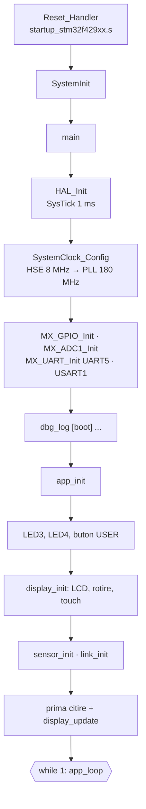
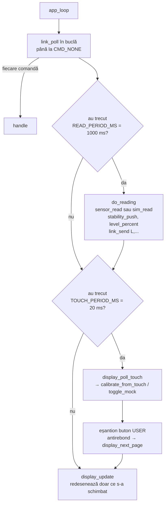
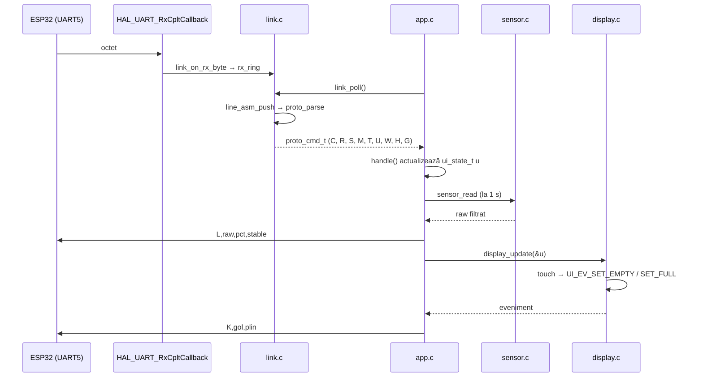
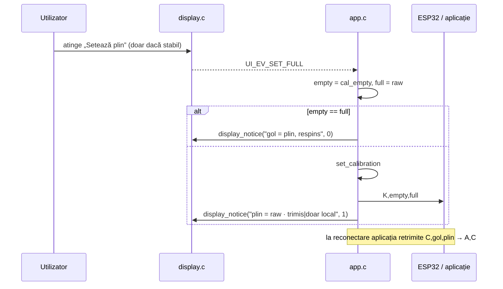
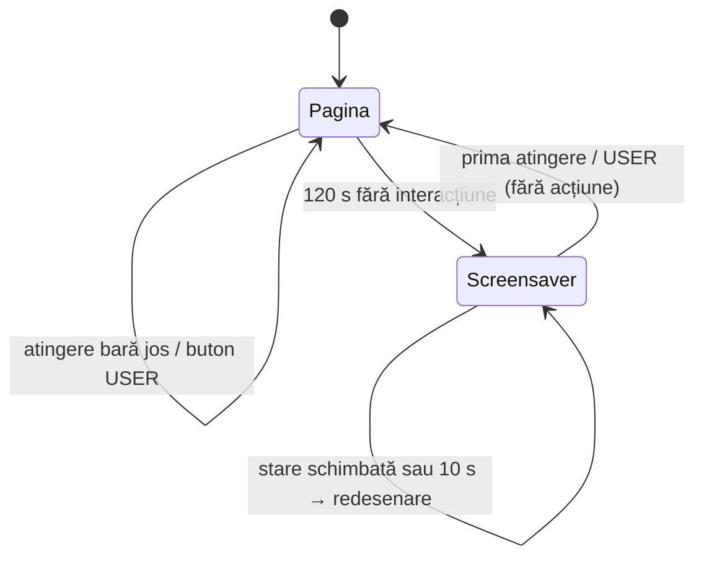

# Firmware STM32 (STM32F429I-DISC1)

Vezi și: [index](README.md) · [protocol](../PROTOCOL.md) · [README principal](../README.md) · [puntea ESP32](punte-esp32.md) · [aplicația web](aplicatia-web.md) · [module web și cloud](module-web-si-cloud.md)

## 1. Rol și context

Placa STM32F429I-DISC1 e singurul nod care atinge senzorul: îl citește o dată pe secundă (senzor analogic pe PA5 sau celulă de sarcină cu HX711), filtrează valoarea, calculează procentul față de calibrare și trimite `L,<raw>,<pct>,<stable>` pe UART5 spre ESP32. ESP32 e doar punte BLE ([punte-esp32.md](punte-esp32.md)); conversia în mL, detecția înghițiturilor și istoricul se fac în aplicația web ([aplicatia-web.md](aplicatia-web.md)). Placa mai desenează un meniu tactil pe LCD-ul de 240 × 320 cu ce primește înapoi de la aplicație (mL, total azi, obiectiv) și de la ESP32 (heartbeat, istoricul nivelului). Calibrarea stă doar în RAM: aplicația e sursa de adevăr și o retrimite cu `C,...` la fiecare conectare.

## 2. Structura fișierelor

Toate căile sunt relative la `smart-bottle/`.

| Fișier | Responsabilitate |
|---|---|
| `stm32/Core/Src/main.c` | Pornire: HAL, ceasuri 180 MHz, GPIO, ADC1, UART5 + USART1; `dbg_log()`, `Error_Handler()`; bucla `while(1) app_loop()` |
| `stm32/Core/Inc/main.h` | Handle-urile `hadc1`, `huart5`, `huart1`; selecția UART-ului protocolului (`LINK_HUART`, `LINK_INSTANCE`) după `LINK_VCP` |
| `stm32/Core/Src/app.c`, `Inc/app.h` | Logica aplicației: planificarea buclei, citiri, comenzi primite, calibrare din meniu, senzor simulat, LED-uri, buton USER |
| `stm32/Core/Inc/app_config.h` | Toate constantele de configurare: varianta de senzor, pini, achiziție, stabilitate, calibrare implicită, rotire LCD, screensaver |
| `stm32/Core/Src/sensor.c`, `Inc/sensor.h` | Achiziția: ADC cu alimentare comutată sau HX711 prin bit-bang |
| `stm32/Core/Src/filter.c`, `Inc/filter.h` | Cod C pur: medie trunchiată, detecție de stabilitate, procent din calibrare |
| `stm32/Core/Src/protocol.c`, `Inc/protocol.h` | Cod C pur: parsarea liniilor primite, formatarea `L`/`K`, asamblarea liniilor din fluxul de octeți |
| `stm32/Core/Src/link.c`, `Inc/link.h` | UART-ul legăturii: recepție pe întreruperi într-un ring buffer, transmisie blocantă, callback-urile HAL |
| `stm32/Core/Src/display.c`, `Inc/display.h` | Meniul LCD (4 pagini), atingeri, notificări, screensaver, rotire; definește `ui_state_t` |
| `stm32/Core/Src/ui_gfx.c`, `Inc/ui_gfx.h` | Primitive de desen în framebuffer ARGB8888: dreptunghiuri rotunjite antialiasate, text UTF-8 antialiasat, compunere în SDRAM fără pâlpâire; paleta de culori |
| `stm32/Core/Src/fonts_ui.c` | **Generat** de `stm32/tools/gen_fonts.py`: cinci fonturi bitmap 4 biți/pixel |
| `stm32/Core/Src/stm32f4xx_hal_msp.c` | Pini și ceasuri pentru ADC1 (PA5), UART5 (PC12/PD2), USART1 (PA9/PA10); prioritățile NVIC |
| `stm32/Core/Src/stm32f4xx_it.c` | Vectorii de întrerupere: SysTick, UART5, USART1; faulturile duc în `Error_Handler()` |
| `stm32/Core/Src/syscalls.c` | Apeluri de sistem minime pentru newlib-nano (doar `_sbrk` contează); numai pentru GCC |
| `stm32/Core/Src/system_stm32f4xx.c` | ST/CMSIS: `SystemInit()` (FPU, tabela de vectori) și `SystemCoreClockUpdate()` |
| `stm32/Core/Inc/stm32f4xx_hal_conf.h` | Configurarea HAL (ST, modulele activate, `HSE_VALUE`) |
| `stm32/startup_stm32f429xx.s` | Pornirea ST pentru GCC: tabela de vectori, copierea `.data`, zero pe `.bss`, apel `SystemInit` și `main` |
| `stm32/STM32F429ZITX_FLASH.ld` | Scriptul de link GCC |
| `stm32/Makefile` | Build, scriere pe placă, monitor serial, variante |
| `stm32/tools/fetch_deps.py` | Descarcă driverele ST și fonturile BSP la commit-uri fixate |
| `stm32/tools/gen_fonts.py` | Regenerează `fonts_ui.c` din TTF-uri |
| `stm32/tools/vcp_test.py` | Test de protocol de pe PC, cu firmware-ul compilat `LINK=vcp` |
| `tests/test_host.c` | Teste unitare pe PC pentru `filter.c` și `protocol.c` |
| `stm32-keil/` | Proiect Keil µVision care compilează aceleași surse din `../stm32` |
| `stm32-cubeide/` | Proiect STM32CubeIDE cu fișiere legate din `../stm32` |
| `stm32/Drivers/`, `stm32/Utilities/` | Cod ST (HAL, CMSIS, BSP placă, componente ili9341/stmpe811/l3gd20, fonturi) — nu sunt în git, le aduce `fetch_deps.py` |

## 3. Arhitectură / flux

Firmware-ul e bare-metal, fără RTOS: o singură buclă cooperativă. Singura activitate pe întreruperi e recepția UART (un octet pe întrerupere) și SysTick-ul HAL (1 ms).





Fluxul datelor între ISR, buclă, senzor și ESP32:



## 4. Module în detaliu

### 4.1 `stm32/Core/Src/main.c` și `stm32/Core/Inc/main.h`

**Responsabilitate:** inițializarea hardware-ului și predarea controlului către `app.c`. Nu e proiect CubeMX (nu există `.ioc`); funcțiile `MX_*` sunt scrise de mână în stilul CubeMX.

**Secvența de pornire (`main()`):**

1. `HAL_Init()` — SysTick la 1 ms (sursa pentru `HAL_GetTick()`/`HAL_Delay()`).
2. `SystemClock_Config()` — HSE 8 MHz (cristalul X3 de pe DISC1), PLL: M = 8, N = 360, P = 2 → SYSCLK 180 MHz; Q = 7. `HAL_PWREx_EnableOverDrive()` e obligatoriu peste 168 MHz. AHB /1 (180 MHz), APB1 /4 (45 MHz), APB2 /2 (90 MHz), `FLASH_LATENCY_5`. Ceasul LTDC (pixel clock) îl setează BSP-ul LCD, nu aici.
3. `MX_GPIO_Init()` — PE4 (alimentare senzor) și PE3 (SCK HX711) ieșiri push-pull pornite LOW; PE2 (DT HX711) intrare cu pull-up. Se configurează indiferent de varianta de senzor.
4. `MX_ADC1_Init()` — ADC1, 12 biți, conversie unică pornită software, prescaler PCLK2/4 = 22,5 MHz, canal 5 (PA5), timp de eșantionare 84 de cicluri („senzorul are impedanță mare”).
5. `MX_UART_Init()` de două ori: UART5 și USART1, ambele 115200 8N1, fără control de flux. În ambele variante de build se inițializează amândouă.
6. `dbg_log("[boot] Smart Bottle <FW_VERSION>, <MHz> MHz, senzor ..., legatura pe ...")`.
7. `app_init()`, apoi `[boot] app pornita` și bucla infinită `app_loop()`.

**API public:**

| Simbol | Descriere |
|---|---|
| `hadc1`, `huart5`, `huart1` | Handle-uri HAL globale, folosite de `sensor.c`, `link.c`, `stm32f4xx_it.c` |
| `LINK_HUART`, `LINK_INSTANCE` (macro în `main.h`) | `huart5`/`UART5` normal; `huart1`/`USART1` cu `LINK_VCP=1` |
| `void dbg_log(const char *fmt, ...)` | `vsnprintf` într-un buffer de 128 B, apoi `HAL_UART_Transmit` blocant pe USART1 (timeout 20 ms). Mesajele mai lungi sunt trunchiate la 127 caractere. Cu `LINK_VCP` funcția nu face nimic, ca jurnalul să nu se amestece cu protocolul. |
| `void Error_Handler(void)` | Dezactivează întreruperile, configurează PG14 (LD4 roșu) și îl comută la nesfârșit cu o buclă de întârziere (~2 000 000 iterații). Nu revine niciodată. |
| `assert_failed()` | Doar cu `USE_FULL_ASSERT`; duce în `Error_Handler()`. |

`FW_VERSION` vine din `make` (`git describe --always --dirty`); altfel e `"dev"` (Keil, CubeIDE).

### 4.2 `stm32/Core/Src/app.c` și `stm32/Core/Inc/app.h`

**Responsabilitate:** orchestrarea tuturor modulelor și deținerea stării afișate.

**Stare:**

| Variabilă | Conținut |
|---|---|
| `static ui_state_t u` | Tot ce afișează meniul (vezi 4.8) |
| `s.last_read_ms`, `s.last_touch_ms` | Momentele ultimei citiri și ultimei interogări tactile |
| `s.btn_hist` | Ultimele 8 eșantioane ale butonului USER, câte unul la 20 ms |
| `s.stab` | Detectorul de stabilitate (`stability_t`), fereastră `STABLE_WINDOW`, prag `STABLE_THRESHOLD` |
| `sim` | Starea senzorului simulat: `level` 0..1000, `next_ms`, `seed` |

**API public:** `app_init()` și `app_loop()` (comentariul din `app.h` încă vorbește de „USER CODE BEGIN 2” din CubeMX, dar aici le apelează direct `main()`).

**`app_init()`:** calibrare implicită (`CAL_DEFAULT_EMPTY`/`CAL_DEFAULT_FULL`), `sensor_ok = 1`, `since_min = -2` (necunoscut), `stability_init`, `BSP_LED_Init(LED3/LED4)`, `BSP_PB_Init(BUTTON_KEY, BUTTON_MODE_GPIO)` (butonul albastru B1 pe PA0, activ pe 1), `display_init()`, `sensor_init()`, `link_init()`, o primă citire și primul `display_update()`.

**Planificarea în `app_loop()`** (toate intervalele măsurate cu `HAL_GetTick()`, cu scădere fără semn, deci corecte și la depășirea contorului de 32 de biți):

| Pas | Frecvență | Ce face |
|---|---|---|
| `link_poll()` + `handle()` | la fiecare trecere | Golește toate comenzile complete primite |
| `do_reading()` | `READ_PERIOD_MS` = 1000 ms | Citire + trimitere `L` |
| `display_poll_touch()` | `TOUCH_PERIOD_MS` = 20 ms | Evenimente tactile → calibrare sau comutare mock |
| Buton USER | 20 ms (același bloc) | Antirebond, apoi `display_next_page()` |
| `display_update(&u)` | la fiecare trecere | Ieftin dacă nu s-a schimbat nimic |

Bucla nu are temporizare proprie: rulează cât de repede permite `display_update`; perioadele de mai sus sunt minime, nu exacte. O citire de senzor blochează bucla cât durează (vezi 4.3).

**Antirebond pentru butonul USER:** la fiecare 20 ms se adaugă un bit în `btn_hist`; o apăsare e recunoscută când ultimele 4 eșantioane sunt `0011` (două eliberate, apoi două apăsate = 40 ms stabil). Ținerea apăsată nu repetă.

**`do_reading()`:** citește din `sim_read()` dacă `u.mock`, altfel `sensor_read()`.
- succes: `sensor_ok = 1`, `raw`, `stable = stability_push()`, `pct = level_percent(raw, cal_empty, cal_full)`, apoi `proto_format_level()` + `link_send()`. Mesajul `L` pleacă necondiționat; ESP32 îl aruncă dacă nu e niciun telefon conectat.
- eșec: `sensor_ok = 0`, `stable = 0`, `stability_reset()`, `BSP_LED_Toggle(LED4)` — LD4 roșu își schimbă starea la fiecare citire eșuată (clipire cu perioada citirilor). Nu se trimite nimic.

**`handle()` — efectul fiecărei comenzi** (formatul exact e în [PROTOCOL.md](../PROTOCOL.md)):

| Comandă | Efect în firmware |
|---|---|
| `CMD_CALIBRATE` (`C,a,b`) | `a == b` → răspunde `E,C`; altfel `set_calibration()` (recalculează și `pct` cu `raw` curent) și răspunde `A,C` |
| `CMD_READ_NOW` (`R`) | `do_reading()` imediat și repornește perioada de 1 s |
| `CMD_LINK_STATE` (`S,0/1`) | `S,0` → `app = 0`; `S,1` → păstrează `app` dacă era deja > 0, altfel `app = 1` (client BLE, aplicația încă necunoscută) |
| `CMD_VOLUME` (`M`) | `has_ml`, `ml`, `cap`; `last_app_ms` |
| `CMD_TODAY` (`T`) | `has_today`, `total`, `goal`, `sips`; `last_app_ms` |
| `CMD_SINCE` (`U`) | `since_min`, `since_at_ms`; `last_app_ms` |
| `CMD_DAY` (`W,i,ml`) | `week[i]`; `has_week = 1` când vine `i == 0`; `last_app_ms` |
| `CMD_HISTORY` (`G,i,p`) | `hist[i] = p`, `has_hist = 1` |
| `CMD_HEARTBEAT` (`H,up,app`) | dacă uptime-ul a scăzut față de precedentul → `esp_restarts++`; `esp_uptime`, `esp_last_ms`; `set_app(app)` (resincronizează și după un `S` pierdut) |
| `CMD_INVALID` | ignorat |

**LED-uri:** `set_app()` aprinde LD3 (verde, PG13) **doar pentru `app == 2`** (aplicație activă după heartbeat-ul ESP32), nu la simpla conexiune BLE. LD4 (roșu, PG14) comută la eroare de senzor; clipirea rapidă continuă a LD4 înseamnă `Error_Handler()`.

**Calibrare din meniul tactil — `calibrate_from_touch(full)`:** butonul „Setează gol” ia `raw` curent ca gol și păstrează plinul; „Setează plin” invers. Dacă cele două ar fi egale, afișează „gol = plin, respins” și nu schimbă nimic. Altfel aplică local și trimite `K,<gol>,<plin>` (`proto_format_cal`), apoi notificarea „gol = 1234 · trimis” (dacă `app == 2`) sau „· doar local”. `K` pleacă oricum; aplicația îl salvează și devine sursa de adevăr. Butoanele sunt active doar când `sensor_ok && stable` (`cal_enabled()` din `display.c`).



**Senzorul simulat (mock):** comutatorul „Senzor simulat” de pe pagina de calibrare apelează `toggle_mock()`: pornește cu nivelul 80 %, reseedează generatorul cu `HAL_GetTick()`, prima „înghițitură” la 10 s, resetează stabilitatea și afișează o notificare. `sim_read()`:
- la fiecare `next_ms`: dacă nivelul < 15 % → reumplere la 100 %; altfel scade 4..11 % (`40 + rand(70)` din 1000); următorul eveniment peste 15..40 s;
- valoarea brută = `cal_empty + (cal_full − cal_empty) · level / 1000 ± 2` (zgomot), deci urmărește calibrarea curentă și produce procente plauzibile;
- generator: LCG `seed * 1664525 + 1013904223`.

Mock-ul nu poate eșua, deci în modul simulat LD4 nu clipește. Pe LCD, pastila de stare arată „simulat” în loc de „stabil”, iar pe Info „Senzor” devine galben.

### 4.3 `stm32/Core/Src/sensor.c` și `stm32/Core/Inc/sensor.h`

**API:** `void sensor_init(void)`; `int sensor_read(int32_t *out)` — întoarce 1 și pune valoarea filtrată în `*out`, sau 0 la eșec. Varianta e aleasă la compilare cu `SENSOR_USE_HX711`.

**Varianta analogică (implicită):**
- `sensor_init()` lasă PE4 LOW: senzorul stă nealimentat între citiri „ca să nu corodeze electrozii” (electroliză pe senzorul rezistiv).
- `sensor_read()`: PE4 HIGH → `HAL_Delay(SENSOR_SETTLE_MS)` (5 ms) → `SAMPLES_PER_READING` (15) conversii cu `adc_sample()` (start, poll cu timeout 10 ms, stop) → PE4 LOW. Senzorul e alimentat ~5 ms + 15 conversii per secundă.
- Eșec dacă reușesc mai puțin de jumătate din eșantioane (`n < 7`). Cu 15 eșantioane valide se elimină `TRIM_COUNT` = 3 de la fiecare capăt; cu mai puține, `n / 5`.
- Domeniu: 0..4095 (12 biți).

**Varianta HX711 (`SENSOR=hx711`):**
- `sensor_init()` pornește contorul de cicluri DWT (`dwt_init`) pentru `delay_us()` și lasă SCK LOW (HX711 activ).
- `hx711_sample()`: așteaptă ca DT să coboare (dată gata) cu timeout `HX711_TIMEOUT_MS` = 200 ms (lipsă modul / cablaj → eșec). Apoi, **cu întreruperile dezactivate**, 24 de impulsuri SCK (HIGH, 1 µs, citește DT, LOW, 1 µs), MSB primul, plus al 25-lea impuls care selectează canalul A cu câștig 128 pentru conversia următoare. Motivul pentru `__disable_irq()`: SCK HIGH mai mult de 60 µs pune HX711 în power-down; secvența durează ~50 µs. Rezultatul de 24 de biți în complement față de 2 e extins la semn pe 32 de biți.
- `sensor_read()`: 15 eșantioane, aceeași regulă de jumătate și aceeași medie trunchiată. La 80 SPS (RATE la VCC) o citire durează ~190 ms; la 10 SPS ar dura ~1,5 s (neverificat pe hardware).

### 4.4 `stm32/Core/Src/filter.c` și `stm32/Core/Inc/filter.h`

Cod C pur, fără HAL, compilat și în testele de pe PC.

| Funcție | Comportament |
|---|---|
| `int32_t filter_trimmed_mean(int32_t *s, int n, int trim)` | Sortează vectorul pe loc (sortare prin inserție, potrivită pentru n mic), aruncă `trim` valori de la fiecare capăt și face media restului cu rotunjire corectă și pentru negative (HX711). `n <= 0` → 0; `trim < 0` → 0; `2·trim >= n` → mediana `s[n/2]`. Suma e pe 64 de biți. Elimină spike-urile ca o mediană și netezește ca o medie. |
| `stability_init(st, window, threshold)` | Fereastra e limitată la 1..`STAB_MAX_WINDOW` (16) |
| `stability_reset(st)` | Golește fereastra (`count = head = 0`) |
| `int stability_push(st, value)` | Buffer circular; întoarce 1 doar când fereastra e plină și `max − min <= threshold` |
| `int level_percent(raw, empty, full)` | `(raw − empty)·100 / (full − empty)`, pe 64 de biți, trunchiat și limitat la 0..100. Merge și cu `full < empty` (senzor inversat). `full == empty` → 0. |

Consecință practică: după pornire, după o eroare de senzor sau după comutarea mock, `stable` e 0 cel puțin `STABLE_WINDOW` = 5 citiri (~5 s).

### 4.5 `stm32/Core/Src/protocol.c` și `stm32/Core/Inc/protocol.h`

Cod C pur, testabil pe PC. Mesajele și semantica lor sunt în [PROTOCOL.md](../PROTOCOL.md); aici doar regulile de implementare.

**Tipuri:** `proto_cmd_type_t` (`CMD_NONE`, `CMD_CALIBRATE`, `CMD_READ_NOW`, `CMD_LINK_STATE`, `CMD_VOLUME`, `CMD_TODAY`, `CMD_SINCE`, `CMD_DAY`, `CMD_HEARTBEAT`, `CMD_HISTORY`, `CMD_INVALID`); `proto_cmd_t { type, a, b, c }`. Constante: `PROTO_LINE_MAX` = 32 (inclusiv terminatorul), `HIST_POINTS` = 60.

**`proto_parse(const char *line)`:**
- linie `NULL`, goală sau doar spații → `CMD_NONE`; orice altceva care nu se potrivește → `CMD_INVALID`;
- spațiile de la început și de la sfârșit sunt tolerate (deci și `\r`); între câmpuri nu sunt permise spații;
- numerele sunt zecimale cu semn, citite cu `strtol` și verificate la depășire și la domeniul `int32_t`;
- numărul de câmpuri trebuie să fie exact (`parse_fields`), altfel invalid;
- validări de domeniu: `S` ∈ {0,1}; `M`: ml ≥ 0, capacitate > 0; `T`: total ≥ 0, obiectiv > 0, nr ≥ 0; `U` ≥ −1; `W`: zi 0..6, ml ≥ 0; `H`: uptime ≥ 0, aplicație 0..2; `G`: index 0..59, procent −1..100. Validarea indicilor aici e ce face sigure scrierile `u.week[c->a]` și `u.hist[c->a]` din `app.c`.
- `C` nu are restricții de domeniu (valorile HX711 pot fi negative).

**Formatare:** `proto_format_level()` → `L,<raw>,<pct>,<0|1>\n`; `proto_format_cal()` → `K,<gol>,<plin>\n`. Ambele întorc lungimea sau 0 dacă nu încape în `cap`. Cel mai lung caz HX711 are 17 respectiv 19 octeți (testat), deci încap în bufferele de `PROTO_LINE_MAX`.

**Asamblarea liniilor (`line_asm_t`):**
- `line_asm_push()` adaugă un octet; la `\n` întoarce 1 dacă există o linie completă în `la->buf` (terminată cu `\0`, fără `\r` final);
- liniile goale sunt ignorate;
- o linie care depășește 31 de caractere pune `overflow = 1`, iar restul până la `\n` e aruncat întreg (nu se trunchiază și nu se interpretează o bucată);
- bufferul rămâne valid până la următorul push, de aceea `link_poll()` parsează imediat.

### 4.6 `stm32/Core/Src/link.c` și `stm32/Core/Inc/link.h`

**Responsabilitate:** transportul liniilor pe UART-ul legăturii (`LINK_HUART`).

**Recepție:** `HAL_UART_Receive_IT()` pe câte un octet (`rx_byte`). `HAL_UART_RxCpltCallback` → `link_on_rx_byte()` pune octetul în `rx_ring[128]` (putere a lui 2, mascare cu `& 127`) și rearmează recepția. Producător unic (ISR scrie doar `rx_head`), consumator unic (bucla scrie doar `rx_tail`), deci nu e nevoie de secțiuni critice. Buffer plin → octetul nou se pierde (capacitate efectivă 127).

**`link_poll()`:** consumă octeți din inel prin `line_asm_push()`; la fiecare linie completă scrie `[rx] <linie>` în jurnal, o parsează și întoarce prima comandă diferită de `CMD_NONE` (inclusiv `CMD_INVALID`). Restul octeților rămân pentru apelul următor; `app_loop()` îl apelează în buclă până la `CMD_NONE`.

**Transmisie:** `link_send(s, len)` — `HAL_UART_Transmit` blocant, timeout 50 ms, apoi `[tx] ...` în jurnal. `link_send_str(s)` — varianta cu `strlen`.

**Erori:** `HAL_UART_ErrorCallback` (overrun, zgomot, cadru) pe UART-ul legăturii șterge flag-ul ORE și repornește recepția; altfel HAL ar lăsa recepția oprită.

**Varianta VCP:** cu `LINK_VCP=1` protocolul circulă pe USART1 (portul serial virtual al ST-LINK, PA9/PA10), iar `dbg_log()` tace. UART5 rămâne inițializat dar nefolosit. Ambele IRQ-uri sunt activate în `HAL_UART_MspInit`; callback-urile filtrează după `LINK_INSTANCE`.

### 4.7 `stm32/Core/Src/stm32f4xx_hal_msp.c`, `stm32f4xx_it.c`, `syscalls.c`, `system_stm32f4xx.c`, `startup_stm32f429xx.s`

- `stm32f4xx_hal_msp.c`: `HAL_MspInit()` (SYSCFG, PWR); `HAL_ADC_MspInit()` → PA5 analogic; `HAL_UART_MspInit()` → UART5 pe PC12/PD2 (AF8), USART1 pe PA9/PA10 (AF7), pull-up, viteză maximă, NVIC prioritate 5. LCD, SDRAM, SPI5 și I2C3 le inițializează BSP-ul.
- `stm32f4xx_it.c`: `SysTick_Handler` → `HAL_IncTick()`; `UART5_IRQHandler`, `USART1_IRQHandler` → `HAL_UART_IRQHandler`; HardFault/MemManage/BusFault/UsageFault → `Error_Handler()`; NMI → buclă infinită.
- `syscalls.c` (doar GCC/newlib-nano): `_sbrk()` crește heap-ul de la `_end` până la `_estack − _Min_Stack_Size` (heap-ul e folosit de `snprintf`); restul (`_write`, `_read` etc.) sunt stub-uri. Keil nu îl include în proiect.
- `system_stm32f4xx.c` (ST): `SystemInit()` activează FPU și setează tabela de vectori; `SystemCoreClock` e actualizat de HAL după configurarea ceasului.
- `startup_stm32f429xx.s` (ST, sintaxă GCC): tabela de vectori, `Reset_Handler` (copiază `.data`, golește `.bss`, apelează `SystemInit`, constructorii statici și `main`), handler-ele implicite slabe. Keil are propria copie în sintaxă armasm în `stm32-keil/startup_stm32f429xx.s`, cu stivă de 4 KB și heap de 512 B.

### 4.8 `stm32/Core/Inc/display.h` — modelul `ui_state_t`

`ui_state_t` e singura interfață între logică și afișaj: `app.c` scrie, `display.c` doar citește (o copie, `shown`, pentru a detecta schimbările).

| Câmp | Sursa | Scris de | Semnificație |
|---|---|---|---|
| `raw`, `pct`, `stable`, `sensor_ok` | senzor local (sau mock) | `do_reading()` | ultima citire filtrată, procent 0..100, stabil 0/1, citire reușită |
| `cal_empty`, `cal_full` | aplicație (`C`) sau meniul tactil | `set_calibration()` | calibrarea curentă, doar în RAM |
| `app` | ESP32 (`S`, `H`) | `set_app()` | 0 niciun client BLE, 1 client dar aplicația nu răspunde, 2 aplicație activă |
| `mock` | meniul tactil | `toggle_mock()` | senzor simulat |
| `last_app_ms` | aplicație (`M/T/U/W`) | `handle()` | ultimul mesaj de la aplicație, 0 = niciodată |
| `has_ml`, `ml`, `cap` | aplicație (`M`) | `handle()` | volum curent și capacitate în mL |
| `has_today`, `total`, `goal`, `sips` | aplicație (`T`) | `handle()` | total azi, obiectiv, nr. înghițituri |
| `since_min`, `since_at_ms` | aplicație (`U`) | `handle()` | minute de la ultima înghițitură (−1 niciuna, −2 necunoscut) |
| `has_week`, `week[7]` | aplicație (`W`) | `handle()` | mL pe ultimele 7 zile, `week[6]` = azi |
| `has_hist`, `hist[60]` | ESP32 (`G`) | `handle()` | procent la fiecare 10 s pe ultimele 10 min, −1 = fără citiri, `[59]` = acum |
| `esp_last_ms`, `esp_uptime`, `esp_restarts` | ESP32 (`H`) | `handle()` | ultimul heartbeat, uptime, numărul de reporniri detectate |

`ESP_TIMEOUT_MS` = 5000: ESP32 e considerat viu dacă ultimul `H` (trimis la 2 s) e mai nou de 5 s. Evenimente: `ui_event_t` = `UI_EV_NONE`, `UI_EV_SET_EMPTY`, `UI_EV_SET_FULL`, `UI_EV_TOGGLE_MOCK`.

### 4.9 `stm32/Core/Src/display.c` — meniul LCD

**API:**

| Funcție | Descriere |
|---|---|
| `display_init()` | `BSP_LCD_Init()`, rotirea opțională, strat de fundal la `LCD_FRAME_BUFFER` (SDRAM), `gfx_init()`, fundal, `BSP_TS_Init(240, 320)` (dacă eșuează, atingerile sunt ignorate) |
| `display_update(st)` | Redesenează incremental pagina curentă sau screensaver-ul |
| `display_poll_touch(st)` | Detectează frontul de atingere și întoarce un `ui_event_t` |
| `display_next_page()` | Pagina următoare (buton USER), circular |
| `display_notice(msg, ok)` | Notificare de 4 s (`NOTICE_MS`) pe pagina de calibrare; verde (`ok = 1`) sau roz |

**Pagini** (bara de jos, `TAB_NAMES`): antetul comun are titlul „Smart Bottle” și o pastilă de stare a legăturii, calculată de `link_state()`:

| `link_state` | Condiție | Text pastilă |
|---|---|---|
| 0 | fără heartbeat `H` în ultimele 5 s | „Fără ESP32” |
| 1 | ESP32 viu, `app == 0` | „Deconectat” |
| 2 | ESP32 viu, `app == 1` | „App nu răsp.” |
| 3 | ESP32 viu, `app == 2` | „Conectat” |

| Pagină | Conținut |
|---|---|
| **Acasă** (`PAGE_HOME`) | Sticlă desenată cu apă în gradient și fund rotunjit antialiasat (`draw_water()`), umplută după `pct` local (nu după mL, care vin doar la citiri stabile); număr mare: mL dacă `has_ml`, altfel procent („–” la eroare de senzor); „X% din CAP mL” sau „fără date mL”; pastilă „stabil”/„simulat”/„se mișcă”/„eroare senzor”; „brut <raw>” |
| **Istoric** (`PAGE_HIST`) | Grafic cu 60 de bare (3 px fiecare) din `hist[]`, axe 0/50/100 %, etichete „-10 min”, „-5”, „acum”; ultima bară în culoare de accent; valoarea cea mai recentă în colț. Fără date: „Aștept istoricul de la ESP32” |
| **Calib.** (`PAGE_CAL`) | Citirea brută curentă; pastila de stare („stabil · poți calibra”) sau notificarea activă; butoanele „Setează gol”/„Setează plin” (gri și inactive dacă nu e stabil); comutatorul „Senzor simulat” |
| **Info** (`PAGE_INFO`) | 9 rânduri: Firmware (`FW_VERSION`), Funcționare (hh:mm:ss de la pornire), Senzor, Legătură (UART5 · ESP32 / USB (test)), ESP32 (fără semnal / nu răsp., acum X / activ · uptime · N rep.), Aplicație (activă / nu răspunde / neconectată), Date aplicație (vechimea lui `last_app_ms`), Calibrare (gol / plin), Obiectiv |

`week[]`, `since_min` și `sips` sunt primite și stocate, dar nicio pagină nu le afișează (vezi Limitări).

**Redesenare incrementală (`display_update`)**:
- schimbare de pagină (`page != drawn_page`): toată pagina e compusă în SDRAM și copiată o dată (static + tab-uri + antet + dinamic);
- altfel, partea dinamică a paginii se redesenează doar dacă `state_changed()` (memcmp pe `ui_state_t`, ignorând `last_app_ms`, `esp_last_ms`, `esp_uptime`, care se schimbă la fiecare heartbeat); pagina Info se redesenează și la fiecare secundă (ceas, vechimi);
- antetul se redesenează doar când `link_state()` se schimbă;
- sticla de pe Acasă se redesenează doar când procentul se schimbă (`bottle_pct`);
- `display_notice()` forțează redesenarea completă (`drawn_page = -1`); expirarea notificării redesenează partea dinamică a paginii de calibrare.

**Atingeri (`display_poll_touch`)**, apelat la 20 ms: doar frontul „neatins → atins” produce o acțiune (fără repetare cât ții apăsat). Orice atingere resetează temporizatorul screensaver-ului. Cu rotirea activă, coordonatele tactile se oglindesc (`x = 239 − x`, `y = 319 − y`), pentru că panoul tactil nu se rotește odată cu imaginea. Zone: `y >= 270` → tab-ul `(x − 12) / 54`; pe Calib.: `y` 234..271 → `UI_EV_TOGGLE_MOCK`; `y` 172..227 și `cal_enabled()` → gol (`x` 12..115) sau plin (`x` 124..227).

**Screensaver** (`SCREENSAVER_MS` = 120 s fără atingere sau apăsare USER): fundal închis, doar nivelul mare (mL sau %) și „mL · azi total/obiectiv”; poziția verticală se mută la 10 s (anti burn-in) și se redesenează la schimbarea stării. Prima atingere sau apăsare USER doar trezește ecranul, fără altă acțiune.

**Rotire (`LCD_ROTATE_180`)**: imaginea se rotește din hardware, rescriind registrul Display Function Control (0xB6) al ILI9341 cu al doilea octet 0xC7 în loc de 0xA7 (inversează GS și SS); restul codului desenează normal.



### 4.10 `stm32/Core/Src/ui_gfx.c` și `stm32/Core/Inc/ui_gfx.h`

Primitive de desen direct în framebuffer-ul ARGB8888 (240 × 320 × 4 B = 300 KB în SDRAM-ul extern), fără DMA2D.

- **Compunere fără pâlpâire:** `gfx_begin(x, y, w, h)` copiază zona de pe ecran în `SCRATCH` (`LCD_FRAME_BUFFER + 1 MB`, tot în SDRAM) și redirecționează toate desenele acolo; `gfx_end()` copiază zona înapoi pe ecran. Apelurile imbricate nu creează o zonă nouă (`gfx_begin` întoarce 0 și desenul merge în zona deja deschisă); de aceea codul apelează `gfx_end()` doar dacă `own` e 1.
- `gfx_fill`, `gfx_pixel` (cu alpha 0..255, amestec liniar pe canale), `gfx_round_rect` (colțuri antialiasate prin acoperire 4 × 4 sub-eșantioane, `coverage()`), `gfx_card` (umbră decalată + dreptunghi rotunjit cu raza 16), `gfx_circle`.
- **Text:** `gfx_text()` decodează UTF-8 (1–3 octeți), caută glifa prin căutare binară după cod Unicode și o desenează cu alpha 4 biți × 17. Caracterele lipsă cad pe varianta fără diacritice (ă/â → a, î → i, ș → s, ț → t etc.), apoi pe `?`. `gfx_text_width()`, `gfx_text_box()` (șterge caseta cu fundal și aliniază stânga/centru/dreapta).
- **Paleta** (`C_*` în `ui_gfx.h`) e cea a site-ului, întunecată pentru contrast pe TFT. `C_OK`/`C_MID`/`C_LOW` corespund pragurilor `LEVEL_OK_PCT`/`LEVEL_MID_PCT` din `app_config.h`.

### 4.11 `stm32/Core/Src/fonts_ui.c` (generat)

Declarații în `ui_gfx.h`: `ufont_glyph_t { cp, off, w, h, x, y, adv }`, `ufont_t { height, ascent, count, glyphs, bits }`. Fișierul conține cinci fonturi, fiecare cu un vector de biți 4 bpp (doi pixeli pe octet, rânduri aliniate la octet) și tabela de glife sortată după cod:

| Font | Sursă | px | Caractere | Folosit pentru |
|---|---|---|---|---|
| `font_small` | Roboto 500 | 13 | ASCII + diacritice + `·°–` (108) | etichete, pastile, tab-uri |
| `font_body` | Roboto 600 | 16 | idem | „mL”, butoane |
| `font_title` | Roboto 600 | 18 | idem | titlul „Smart Bottle” |
| `font_mono` | JetBrains Mono 600 | 14 | ASCII (95) | „brut <raw>” |
| `font_num` | JetBrains Mono 600 | 36 | ` 0123456789%,.-:/mL` (19) | numerele mari |

Se regenerează cu `stm32/tools/gen_fonts.py` (vezi 6); nu se editează manual.

### 4.12 Unelte: `stm32/tools/`

- `fetch_deps.py`: aduce cu `git fetch --depth 1` la commit-uri fixate depozitele ST `cmsis_device_f4`, `stm32f4xx_hal_driver`, `32f429idiscovery-bsp`, `stm32-bsp-common`, `stm32-ili9341`, `stm32-l3gd20`, `stm32-stmpe811`, plus din `STM32CubeF4` (checkout parțial) `Drivers/CMSIS/Include` și `Utilities/Fonts` (BSP-ul include fonturile prin `../../../Utilities/Fonts`). Șterge `.git` din fiecare. Dacă `Drivers/` există, nu face nimic; `--force` reîncarcă.
- `gen_fonts.py`: cu Pillow, randează Roboto și JetBrains Mono (TTF variabile, axa de greutate setată) la mărimile din `FONTS` și scrie `Core/Src/fonts_ui.c`.
- `vcp_test.py`: test de integrare pe portul serial USB (vezi 6).

## 5. Configurare

### 5.1 `stm32/Core/Inc/app_config.h`

| Constantă | Implicit | Efect |
|---|---|---|
| `SENSOR_USE_HX711` | 0 (`make SENSOR=hx711` → 1) | Alege varianta din `sensor.c` și pragul de stabilitate |
| `SENS_PWR_PORT/PIN` | GPIOE / PIN_4 | Alimentarea comutată a senzorului analogic |
| `HX711_DT_PORT/PIN` | GPIOE / PIN_2 | Datele HX711 |
| `HX711_SCK_PORT/PIN` | GPIOE / PIN_3 | Ceasul HX711 |
| `SAMPLES_PER_READING` | 15 | Eșantioane per citire |
| `TRIM_COUNT` | 3 | Valori eliminate la fiecare capăt (cu 15 eșantioane valide) |
| `SENSOR_SETTLE_MS` | 5 | Așteptare după alimentarea senzorului analogic |
| `READ_PERIOD_MS` | 1000 | Perioada citirilor și a mesajelor `L` |
| `HX711_TIMEOUT_MS` | 200 | Așteptare maximă după DT per eșantion |
| `STABLE_WINDOW` | 5 | Citiri analizate pentru stabilitate |
| `STABLE_THRESHOLD` | 15 (analogic) / 2000 (HX711) | Toleranța max − min în fereastră |
| `CAL_DEFAULT_EMPTY` / `CAL_DEFAULT_FULL` | 0 / 3000 | Calibrarea de la pornire, până vine `C` |
| `LCD_ROTATE_180` | 1 | Imagine rotită (placa ținută cu USB-ul în jos) |
| `SCREENSAVER_MS` | 120000 | 0 dezactivează screensaver-ul |
| `LEVEL_OK_PCT` / `LEVEL_MID_PCT` | 50 / 20 | Praguri de culoare (documentate ca „aceleași ca în aplicație”) |

Notă: `SENS_PWR_*` și `HX711_*` sunt folosite de `sensor.c`, dar `MX_GPIO_Init()` din `main.c` configurează direct PE2/PE3/PE4; la schimbarea unui pin trebuie modificate ambele (comentariul din `app_config.h` spune „schimbă-l doar aici”, ceea ce nu e suficient).

### 5.2 Alte constante

| Constantă | Fișier | Valoare | Efect |
|---|---|---|---|
| `TOUCH_PERIOD_MS` | `app.c` | 20 | Interogare touch + eșantion buton |
| `RX_RING_SIZE` | `link.c` | 128 | Inelul de recepție (putere a lui 2) |
| `PROTO_LINE_MAX` | `protocol.h` | 32 | Linie maximă, inclusiv `\0` |
| `HIST_POINTS` | `protocol.h` | 60 | Puncte de istoric |
| `ESP_TIMEOUT_MS` | `display.h` | 5000 | ESP32 considerat mort fără `H` |
| `NOTICE_MS` | `display.c` | 4000 | Durata notificărilor |
| `SAVER_MOVE_MS` | `display.c` | 10000 | Mutarea textului screensaver-ului |
| `SCRATCH` | `display.c` | `LCD_FRAME_BUFFER + 0x100000` | Zona de compunere în SDRAM |

### 5.3 Definiri la compilare

| Definire | Sursa | Efect |
|---|---|---|
| `STM32F429xx`, `USE_HAL_DRIVER` | toate build-urile | Selecția dispozitivului în CMSIS/HAL |
| `LINK_VCP=1` | `make LINK=vcp`, ținta/configurația `SmartBottle_VCP` | Protocolul pe USART1, jurnal oprit |
| `SENSOR_USE_HX711=1` | `make SENSOR=hx711`, `SmartBottle_HX711` | Celula de sarcină |
| `FW_VERSION="..."` | doar `make` (`git describe --always --dirty`) | Afișat în jurnal și pe pagina Info; altfel `"dev"` |

### 5.4 Harta pinilor

| Pin | Funcție | Configurat în |
|---|---|---|
| PA5 | ADC1_IN5, semnalul senzorului analogic | `HAL_ADC_MspInit()` |
| PE4 | Alimentarea senzorului (ieșire, LOW implicit) | `MX_GPIO_Init()`, `app_config.h` |
| PE2 | HX711 DT (intrare, pull-up) | `MX_GPIO_Init()`, `app_config.h` |
| PE3 | HX711 SCK (ieșire, LOW implicit) | `MX_GPIO_Init()`, `app_config.h` |
| PC12 / PD2 | UART5 TX / RX spre ESP32, 115200 8N1, AF8 | `HAL_UART_MspInit()` |
| PA9 / PA10 | USART1 TX / RX = ST-LINK VCP (jurnal sau protocol în varianta VCP), AF7 | `HAL_UART_MspInit()` |
| PG13 | LD3 verde: aplicație activă | BSP (`BSP_LED_Init`) |
| PG14 | LD4 roșu: comută la eroare de senzor; clipește rapid în `Error_Handler()` | BSP, `Error_Handler()` |
| PA0 | Butonul USER (B1): pagina următoare | BSP (`BSP_PB_Init`) |
| LCD (LTDC + SPI5 pentru ILI9341), SDRAM (FMC), touch STMPE811 (I2C3) | pini ficși ai plăcii | BSP STM32F429I-Discovery |

## 6. Build / rulare / testare

### 6.1 Variante de build

| Variantă | `make` | Keil (`stm32-keil/SmartBottle.uvprojx`) | CubeIDE (`stm32-cubeide/`) |
|---|---|---|---|
| Senzor analogic, protocol pe UART5 spre ESP32 | `make` | ținta `SmartBottle` | configurația `SmartBottle` |
| Protocol pe USB (VCP), fără ESP32 | `make LINK=vcp` | `SmartBottle_VCP` (`LINK_VCP=1`) | `SmartBottle_VCP` (`LINK_VCP=1`) |
| Celulă de sarcină HX711 | `make SENSOR=hx711` | `SmartBottle_HX711` (`SENSOR_USE_HX711=1`) | `SmartBottle_HX711` (`SENSOR_USE_HX711=1`) |

Variantele se pot combina doar cu `make` (`make LINK=vcp SENSOR=hx711`). Între variante rulează `make clean`: obiectele din `build/` nu depind de definirile de pe linia de comandă.

### 6.2 `make` (recomandat)

```
cd stm32
python tools/fetch_deps.py        # o singură dată
make -j8                          # build/smart-bottle.elf, .hex, .bin + dimensiuni
make flash                        # OpenOCD, board/stm32f429disc1.cfg; FLASHER=pyocd | cubeprog
make monitor PORT=COM5            # miniterm 115200 pe portul serial USB
make clean
```

- `check-deps` oprește build-ul cu un mesaj dacă lipsește `Drivers/STM32F4xx_HAL_Driver`.
- Surse: toate `Core/Src/*.c`, tot HAL-ul (fără `*_template.c`) plus `stm32f4xx_ll_fmc.c`, BSP-ul (placă, LCD, SDRAM, touch, ili9341, stmpe811) și `startup_stm32f429xx.s`.
- Opțiuni: Cortex-M4, FPU hard (`fpv4-sp-d16`), `-Os -g3`, `-ffunction-sections -fdata-sections` + `--gc-sections`, newlib-nano. Codul din `Core/` cu `-Wall -Wextra`, driverele ST cu `-w`.
- Comenzile de scriere: `openocd ... "program <elf> verify reset exit"`, `pyocd flash -t stm32f429zitx`, `STM32_Programmer_CLI -c port=SWD -w <elf> -v -rst`.
- Jurnalul de pe USART1 arată `[boot] ...`, apoi `[tx] L,...` la fiecare secundă și `[rx] ...` pentru fiecare linie primită.

### 6.3 Keil µVision (`stm32-keil/`)

Conține doar `SmartBottle.uvprojx`/`.uvoptx` și un `startup_stm32f429xx.s` în sintaxă armasm. Toate sursele sunt referite relativ (`..\stm32\Core\Src\*.c`, `..\stm32\Drivers\...`), aceleași ca la `make`, fără `syscalls.c`. Trei ținte (tabelul de mai sus), Arm Compiler 6, MicroLIB, nivel de optimizare comun, ieșire în `stm32-keil/out/<țintă>/` (`smart-bottle.axf`, `.hex`). Imaginea depășește limita de 32 KB a MDK-Lite. Pașii detaliați sunt în [../README.md](../README.md).

### 6.4 STM32CubeIDE (`stm32-cubeide/`)

`.project` leagă cu `PARENT-1-PROJECT_LOC/stm32/...` folderul `Core`, `startup_stm32f429xx.s`, `STM32F429ZITX_FLASH.ld` și fișierele individuale din `Drivers/`; nu conține cod propriu. `.cproject` are trei configurații (toate de tip debug, optimizare `-Os`), diferite doar prin definiri. Proiectul se importă fără „Copy projects into workspace”, altfel legăturile relative se rup.

### 6.5 Memorie

Din `stm32/build/smart-bottle.map` (build `make`, varianta implicită, existent în repo la data scrierii):

| Secțiune | Dimensiune |
|---|---|
| `.isr_vector` + `.text` | ~30 KB |
| `.rodata` (fonturile domină) | ~36 KB |
| `.data` + `.bss` | ~2,2 KB |
| Heap + stivă rezervate (`_Min_Heap_Size`, `_Min_Stack_Size`) | 8 KB + 4 KB |

Total ordin de mărime: **~66 KB flash din 2 MB**, **~14 KB SRAM din 192 KB**. Framebuffer-ul (300 KB) și zona de compunere sunt în SDRAM-ul extern de 8 MB, în afara scriptului de link. CCMRAM (64 KB) nu e folosit.

### 6.6 Teste

**Teste unitare pe PC (`tests/test_host.c`)**, fără HAL:

```
cd tests
gcc -Wall -Wextra -I../stm32/Core/Inc test_host.c ../stm32/Core/Src/filter.c ../stm32/Core/Src/protocol.c -o t && ./t
```

| Grup | Ce verifică |
|---|---|
| `test_filter` | Media trunchiată elimină spike-uri; valori negative; `trim` prea mare → mediană; `level_percent` la mijloc, sub/peste limite, senzor inversat, calibrare degenerată; `stability_push` (fereastră neplină, stabil, salt, revenire) |
| `test_parse` | Fiecare tip de comandă valid și cazurile invalide (câmpuri lipsă/în plus, text, domenii: `S,2`, `M,450,0`, `U,-2`, `W,7`, `H,12,3`, `H,-1`, `G,60`, `G,3,101`), linie goală → `CMD_NONE`; formatarea `L`/`K` inclusiv cazurile cele mai lungi HX711 (≤ 20 B) |
| `test_line_asm` | `\r\n`, linie împărțită în două bucăți, linii goale ignorate, linie prea lungă aruncată și recuperarea la linia următoare |

Ieșire: `Toate testele au trecut` sau lista `FAIL fișier:linie`; codul de ieșire e nenul la eșec.

**Test pe placă fără ESP32 (`stm32/tools/vcp_test.py`)**, necesită `pyserial`:

```
cd stm32
make clean && make LINK=vcp flash
python tools/vcp_test.py COM5     # fără argument caută automat un port ST-LINK (VID 0x0483)
```

Pași: (1) cel puțin 3 mesaje `L` în ~4,5 s; (2) `R` → `L` în 0,8 s; (3) `C,5,5` → `E,C`, `C,raw−100,raw+100` → `A,C`, apoi procentul între 30 și 70 %; (4) `S,1`/`S,0` cu verificare vizuală manuală. Codul de ieșire e 0 doar dacă verificările automate trec.

## 7. Cum extinzi

**Mesaj nou de la ESP32/aplicație spre STM32** (ex. `X,<a>,<b>`):
1. `stm32/Core/Inc/protocol.h`: adaugi `CMD_X` în `proto_cmd_type_t`, înainte de `CMD_INVALID`, cu formatul în comentariu.
2. `stm32/Core/Src/protocol.c` → `proto_parse()`: un `case 'X':` cu `parse_fields(p, v, N)` și validarea domeniilor (obligatorie dacă valoarea devine index); adaugi `CMD_X` în condiția care copiază `v[]` în `a/b/c`.
3. `tests/test_host.c` → `test_parse()`: cazuri valide și invalide.
4. `stm32/Core/Src/app.c` → `handle()`: efectul (de obicei câmpuri noi în `ui_state_t`).
5. Linia trebuie să încapă în 31 de caractere (`PROTO_LINE_MAX`).
6. Actualizezi [PROTOCOL.md](../PROTOCOL.md) și emițătorul ([punte-esp32.md](punte-esp32.md), [aplicatia-web.md](aplicatia-web.md)).

**Mesaj nou trimis de STM32:** o funcție `proto_format_*()` în `protocol.c` (întoarce 0 dacă nu încape), test în `test_host.c`, apel `link_send()` din `app.c`, apoi documentare în [PROTOCOL.md](../PROTOCOL.md).

**Câmp nou afișat pe LCD:** câmpul în `ui_state_t` (`display.h`), scris în `app.c`; desenat în funcția `*_dynamic()` a paginii. Dacă valoarea se schimbă des fără efect vizibil, o neutralizezi în `state_changed()`, altfel pagina se redesenează la fiecare mesaj.

**Pagină nouă:** valoare nouă în enum-ul de pagini înainte de `PAGE_COUNT`, nume în `TAB_NAMES`, funcții `*_static()`/`*_dynamic()` și ramuri în `display_update()`. Tab-urile au lățimea fixă 54 px (`draw_tabs()`, `display_poll_touch()`); la 5 pagini nu mai încap în 224 px și trebuie recalculate.

**Senzor nou:** o ramură nouă în `sensor.c` sub o definire din `app_config.h`, cu aceeași interfață `sensor_init()`/`sensor_read()` și același filtru; prag `STABLE_THRESHOLD` potrivit domeniului; pinii în `MX_GPIO_Init()` sau în `stm32f4xx_hal_msp.c`; variantă în `Makefile` și ținte/configurații noi în Keil și CubeIDE.

**Text nou pe LCD cu caractere neacoperite:** adaugi caracterele în `FONTS` din `gen_fonts.py` și regenerezi: `pip install pillow`, `python tools/gen_fonts.py Roboto.ttf JetBrainsMono.ttf` (TTF-uri din github.com/google/fonts). Altfel caracterele lipsă apar fără diacritice sau ca `?`; `font_num` are doar cifre și `%,.-:/mL`.

## 8. Limitări cunoscute și riscuri

- **Calibrarea nu supraviețuiește resetului** (doar RAM): după pornire se folosește 0/3000 până când aplicația retrimite `C`. Intenționat (aplicația e sursa de adevăr), dar fără aplicație procentul de pe LCD e greșit după fiecare reset.
- **Bucla e blocată în timpul citirii:** cu HX711 deconectat, fiecare citire așteaptă 15 × 200 ms = 3 s; touch-ul, butonul și afișajul îngheață 3 s din fiecare ~3 s, iar octeții primiți se adună în inelul de 128 B (pot pierde dacă ESP32 trimite mult, ex. 60 de linii `G`).
- **Eroarea senzorului analogic practic nu se detectează:** `adc_sample()` eșuează doar la timeout de conversie; un senzor deconectat dă valori flotante, nu `sensor_ok = 0` și nici LD4.
- **Transmisia e blocantă** (`HAL_UART_Transmit`, timeout 50 ms) și fiecare linie mai generează un `dbg_log` blocant pe USART1 (timeout 20 ms); la 115200 baud o linie durează ~1–2 ms, deci în practică e acceptabil.
- **Inelul de recepție pierde octeți când e plin**, iar o linie cu octeți pierduți poate deveni `CMD_INVALID` (ignorată) sau, mai rar, o comandă validă cu altă valoare; nu există sumă de control.
- **Întreruperile sunt dezactivate ~50 µs per eșantion HX711**; la 115200 baud un octet durează ~87 µs, deci riscul de overrun pe UART e mic, iar `HAL_UART_ErrorCallback` repornește recepția (neverificat pe hardware).
- **Date primite dar neafișate:** `week[]`, `since_min`/`since_at_ms` și `sips` nu apar pe nicio pagină, dar schimbarea lor provoacă redesenări.
- **`gfx_begin` copiază pixel cu pixel prin CPU** (fără DMA2D); redesenarea unei pagini întregi mută 2 × 300 KB prin SDRAM. Comentariul din README despre `-O0` (desen lent) confirmă sensibilitatea la optimizare.
- **Pinii senzorului sunt definiți în două locuri** (`app_config.h` și `MX_GPIO_Init()`); vezi 5.1.
- **Firmware-ul n-a rulat pe hardware la data `HANDOFF-STM32.md`** („never run on real hardware”); comportamentul pe placă (VCP pe PA9/PA10, rotire, touch) e marcat acolo „(check)” și rămâne (neverificat) din cod.

### Neconcordanțe între cod și documentația existentă

| Unde | Ce spune | Ce face codul |
|---|---|---|
| `stm32/tools/vcp_test.py` (docstring și pasul 4), `HANDOFF-STM32.md` pașii 6–7 | După `S,1` LED-ul verde LD3 se aprinde și pe LCD scrie „BLE: conectat”/„BLE: neconectat” | `S,1` pune `app = 1`; LD3 se aprinde doar la `app == 2` (din `H`). LCD-ul nu are textul „BLE: ...”; pastila arată „Fără ESP32” fără heartbeat `H`, deci în varianta VCP rămâne așa dacă testul nu trimite `H` |
| `HANDOFF-STM32.md` pasul 4 | ~36 KB flash | Map-ul actual dă ~66 KB (README spune ~65 KB, consistent cu map-ul) |
| `HANDOFF-STM32.md` pasul 6 | LCD-ul arată „un procent și BLE: neconectat” | UI-ul actual are 4 pagini, pastilă de stare a legăturii, mL/procent |
| `app_config.h` („dacă schimbi un pin, schimbă-l doar aici”) | un singur loc | `MX_GPIO_Init()` din `main.c` folosește pinii direct (README principal spune corect că sunt două locuri) |
| `app.h` | apel din „USER CODE BEGIN 2” al CubeMX | `main.c` nu e generat de CubeMX; apelurile sunt directe |
| `sensor.c` | comentariul „handle-uri generate de CubeMX” | handle-urile sunt definite manual în `main.c` |
