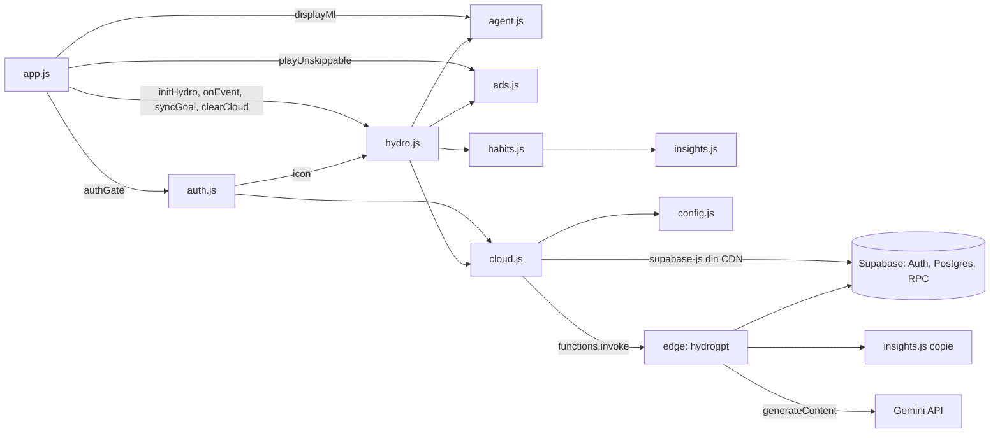
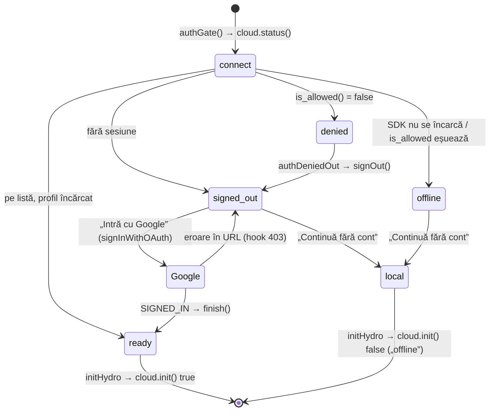
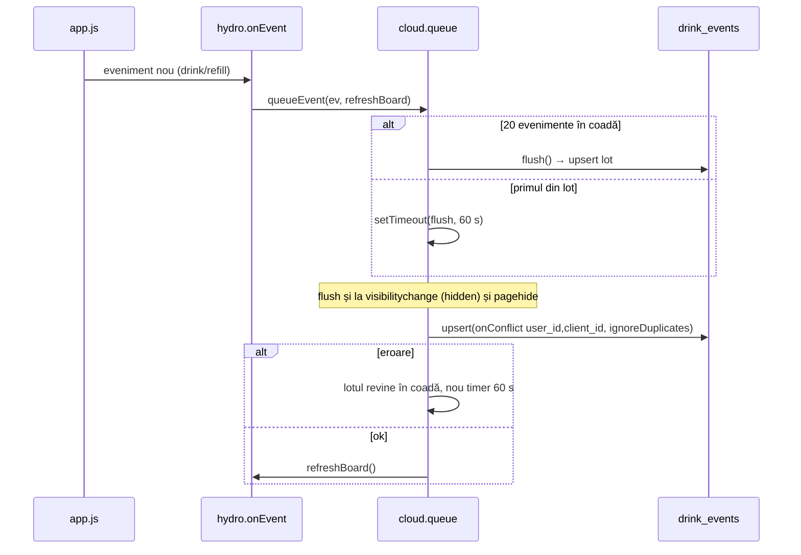
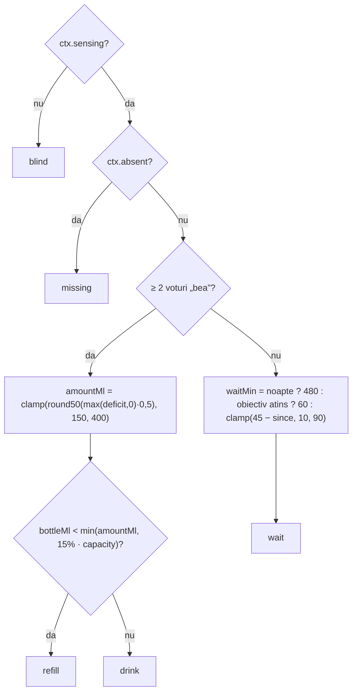
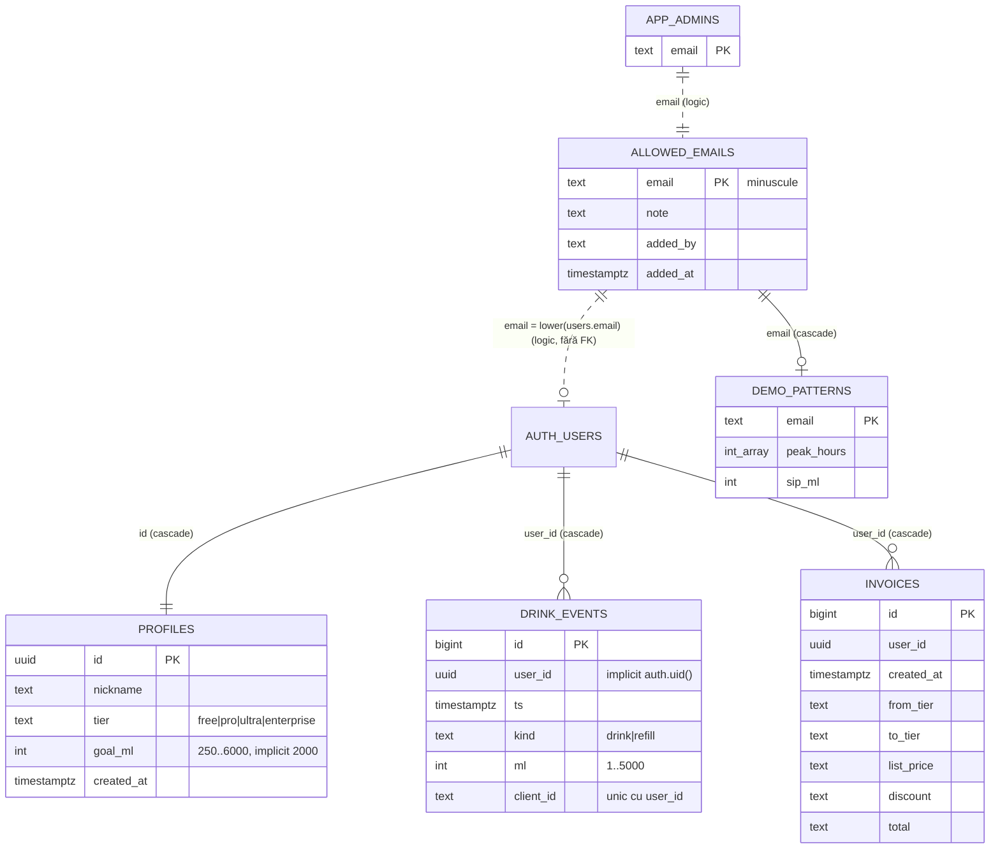

# Module web și cloud: HydroGPT™, abonamente, obiceiuri, reclame, autentificare, Supabase

## 1. Rol și context

Peste aplicația de bază (senzor, calibrare, istoric local — vezi [aplicatia-web.md](aplicatia-web.md)) stă un strat de
module ES fără build, în `web/`: agentul de hidratare HydroGPT™ (`agent.js` + interfața din `hydro.js`), cardul
de obiceiuri (`habits.js` + `insights.js`), reclamele planului Free (`ads.js`), autentificarea (`auth.js`) și clientul
Supabase (`cloud.js` + `config.js`). În cloud, Supabase ține profilurile, istoricul sincronizat, facturile (false),
clasamentul și lista de acces, iar funcția edge `hydrogpt` rulează agentul cu un LLM real (Gemini).
Datele de la sticlă vin în aceste module doar ca evenimente `{ ts, type: 'drink'|'refill', ml }` produse de
`app.js` (protocolul e în [../PROTOCOL.md](../PROTOCOL.md)). Index: [README.md](README.md).

## 2. Structura fișierelor

| Fișier | Responsabilitate |
|---|---|
| `web/agent.js` | Logică pură (fără DOM): abonamentele `TIERS`, rotunjirea afișajului, contextul, Consiliul Organelor, verdictul, replicile, chatul local, raportul KPI |
| `web/hydro.js` | DOM-ul pentru agent, chat, mementouri, abonamente/checkout, clasament, raport Enterprise; pornește `ads.js`, `habits.js` și sincronizarea cloud |
| `web/habits.js` | Cardul „Obiceiurile tale”: încarcă evenimentele, apelează `computeInsights`, desenează două grafice SVG |
| `web/insights.js` | Logică pură: statistici de obiceiuri din evenimente. **Copiat identic** în funcția edge |
| `web/ads.js` | Reclame inventate (banner, card în listă, video „care nu se poate sări”) pentru planul Free |
| `web/auth.js` | Ecranul de intrare cu Google, ieșirea din cont, panoul de administrare a listei de acces |
| `web/cloud.js` | Obiectul singleton `cloud`: client Supabase, sesiune, profil, sincronizare în loturi, RPC-uri, apelul `hydrogpt` |
| `web/config.js` | `SUPABASE_URL` și cheia publishable `SUPABASE_KEY` |
| `supabase/functions/hydrogpt/index.ts` | Funcția edge (Deno): autentificare, verificarea abonamentului, buclă de tool-calling cu Gemini |
| `supabase/functions/hydrogpt/insights.js` | Copia lui `web/insights.js` (Deno nu vede `web/` la deploy) |
| `supabase/sync-shared.sh` | Copiază `web/insights.js` peste copia din funcție |
| `supabase/migrations/20261019120000_hydrogpt.sql` | Schema de bază: `profiles`, `drink_events`, `invoices`, `checkout()`, `leaderboard_today()`, porecle |
| `supabase/migrations/20261019130000_allowlist_auth.sql` | Lista de acces: `allowed_emails`, `app_admins`, hook-ul de creare cont, RLS cu `is_allowed()`, RPC-uri de administrare |
| `supabase/migrations/20261019140000_demo_accounts.sql` | Conturi demo: `demo_patterns`, `demo_tick()`, jobul `pg_cron` `demo-sips` |
| `supabase/migrations/20261019150000_leaderboard_pro.sql` | `leaderboard_today()` întoarce rânduri doar celor de pe Pro în sus |
| `tests/test_agent.mjs` | Teste Node pentru `web/agent.js` |
| `tests/test_insights.mjs` | Teste Node pentru `web/insights.js` + identitatea copiei din funcție |

## 3. Arhitectură / flux

### Dependențe între module



### Pornire și sesiune



### Cerere de chat (Ultra/Enterprise, online)

```mermaid
sequenceDiagram
  participant U as Utilizator
  participant H as hydro.js ask()
  participant C as cloud.askAgent
  participant F as edge hydrogpt
  participant DB as Postgres (RLS)
  participant G as Gemini
  U->>H: întrebare
  H->>H: cotă localStorage, renderVerdict(), think() (reasoningTrace)
  H->>C: {question, ctx, decision, history: ultimele 8}
  C->>F: POST functions/v1/hydrogpt (JWT utilizator)
  F->>DB: auth.getUser(JWT), rpc is_allowed
  F->>DB: select tier, nickname, goal_ml from profiles
  alt tier ∉ {ultra, enterprise}
    F-->>C: 402 {fallback, error:'upgrade'}
  else fără GEMINI_API_KEY
    F-->>C: 503 {fallback}
  end
  loop cel mult MAX_STEPS = 4
    F->>G: generateContent(systemInstruction, contents, tools)
    alt functionCall
      F->>DB: get_drink_history / get_drink_insights (select drink_events, RLS)
      F->>F: get_hydration_status (din ctx trimis) / schedule_reminder → actions
    else text
      F-->>C: 200 {reply, actions, toolCalls, model}
    end
  end
  C-->>H: răspuns sau {fallback, status, ...detaliu}
  H->>U: reply + chip-uri de unelte; setTimeout pentru fiecare remind
  Note over H: la fallback: notă o dată, apoi localReply()
```

### Sincronizarea evenimentelor



## 4. Module în detaliu

### 4.1 `web/agent.js`

Logică pură, testabilă în Node. Comentariul de antet fixează ideea: „Abonamentul decide doar CUM ți se spune,
nu CE” — verdictul e același pe toate planurile, diferă replicile și ce se afișează.

#### Abonamentele: `TIERS`, `TIER_ORDER`

`TIER_ORDER = ['free', 'pro', 'ultra', 'enterprise']`. Fiecare intrare din `TIERS` are `name`, `price`, `blurb`,
`perks` (texte pentru cardurile de abonament) și steagurile:

| Câmp | free | pro | ultra | enterprise | Efect în cod |
|---|---|---|---|---|---|
| `precision` (mL) | 50 | 10 | 1 | 1 | `displayMl()` rotunjește afișajul (`app.js`) |
| `ads` | true | false | false | false | `ads.js` (prin `opts.enabled`) |
| `weekChart` | false | true | true | true | graficul pe 7 zile din `app.js` (vezi [aplicatia-web.md](aplicatia-web.md)) |
| `leaderboard` | false | true | true | true | `hydro.js` → `refreshBoard()` |
| `agent` | false | false | true | true | `agentOn()`: verdict, chat, mementouri, comentarii, cardul de obiceiuri |
| `council` | false | false | true | true | lista de voturi și pașii de raționament compleți |
| `llm` | false | false | true | true | chatul încearcă funcția `hydrogpt` |
| `chatPerDay` | 0 | 0 | ∞ | ∞ | cota zilnică din `localStorage` (`sb.quota.<zi>`) |
| `nudgeMin` (min) | 60 | 20 | 10 | 5 | intervalul minim între mementouri proactive |
| `report` | false | false | false | true | butonul „Raport KPI” |

Unde se aplică fiecare limită:

| Limită | Client | Server |
|---|---|---|
| AI în cloud (`hydrogpt`) | `T().llm && cloud.ready` | **da**: funcția citește `profiles.tier` și răspunde 402 sub Ultra |
| Clasament | `T().leaderboard` | **da**: `leaderboard_today()` nu întoarce nimic pentru tier `free` |
| Schimbarea abonamentului | butoanele din `renderTiers()` | `checkout()` e singura cale (UPDATE pe `tier` e revocat) — dar acceptă orice plan, gratuit |
| Precizie, reclame, agent local, consiliu, obiceiuri, raport, grafic 7 zile, cotă chat | da | nu (doar client) |

Fără cont, `changeTier()` scrie planul direct în `cfg.tier` (factură „locală (offline)”), deci planurile sunt
practic decorative pe partea de client; doar AI-ul din cloud și clasamentul sunt protejate de server.

#### Funcții exportate

| Funcție | Intrare → ieșire | Detalii |
|---|---|---|
| `displayMl(ml, tier)` | număr | `Math.round(ml / precision) * precision`; tier necunoscut → pas 1 |
| `expectedByNow(goal, date)` | mL | curbă liniară între `WAKE_HOUR` (8) și `SLEEP_HOUR` (22): `goal · clamp((h − 8)/14, 0, 1)`, `h` cu minute |
| `buildContext({ now, ml, capacity=750, goal=2000, drinks, connected, calibrated, absent })` | `ctx` | vezi tabelul de mai jos |
| `council(ctx)` | `[{ organ, icon, vote: 'bea'|'așteaptă', reason }]` × 3 | regulile organelor |
| `decide(ctx)` | `{ verdict, votes, amountMl, waitMin }` | verdict ∈ `drink`, `wait`, `refill`, `missing`, `blind` |
| `speak(decision, tier, rng)` | text | replică aleatoare din `LINES[tier][verdict]`; pe Free adaugă „(Mesaj sponsorizat de APA™)” |
| `reasoningTrace(ctx, decision, tier)` | `string[]` | pașii „de gândire” afișați înaintea răspunsului, cu cifrele reale și voturile; sub `council` doar două rânduri generice |
| `reactToEvent(ev, tier, ctx, rng)` | text | comentariu la `drink`/`refill`, cu felicitare când `todayMl ≥ goal` |
| `norm(s)` | text | minuscule, fără diacritice (NFD + eliminarea semnelor combinante) |
| `localReply(question, ctx, tier, rng)` | text | chatul local, pe cuvinte-cheie |
| `kpiReport(ctx, todayEvents)` | `[{ k, v }]` | raportul Enterprise |
| `WAKE_HOUR`, `SLEEP_HOUR` | 8, 22 | constante |

Câmpurile din `ctx` (`buildContext`):

| Câmp | Calcul |
|---|---|
| `sensing` | `connected && calibrated` |
| `bottleMl`, `bottlePct` | `ml`, `round(ml / capacity · 100)` (null fără citire) |
| `todayMl`, `sips` | suma și numărul `drinks` de la miezul nopții locale |
| `goalPct` | `round(todayMl / goal · 100)` |
| `expected`, `deficit` | `expectedByNow(goal)`, `expected − todayMl` |
| `minutesSinceDrink` | de la cel mai recent `drinks[].ts`; null dacă nu există |
| `last30Ml` | suma ultimelor 30 de minute |
| `hour`, `absent`, `now`, `capacity`, `goal` | copiate |

#### Consiliul Organelor și verdictul

Noaptea înseamnă `h ≥ 23 || h < 7` (`isNight`, diferit de `WAKE_HOUR`/`SLEEP_HOUR`). `since` = `minutesSinceDrink ?? 999`.

| Organ | „bea” dacă | „așteaptă” dacă |
|---|---|---|
| Rinichiul | `deficit > 150` sau `since > 90` | altfel |
| Vezica | nu e noapte și `last30Ml < 300` | `last30Ml ≥ 300` sau noapte |
| Creierul | zi, `todayMl < goal`, `since ≥ 45` | noapte, obiectiv atins sau băut de curând |

`decide(ctx)`:



La `wait`, `since` folosește `?? 0` (nu 999), deci fără nicio înghițitură azi ziua așteptarea e 45 min.

#### Chatul local (`localReply`)

Intențiile se verifică în ordine pe textul normalizat (`norm`); prima potrivire câștigă:

| Cuvinte (fără diacritice) | Răspuns |
|---|---|
| `cat am baut`, `status`, `progres`, `cat mai am` | `todayMl / goal (goalPct%)`, înghițituri, deficit |
| `bere`, `vin`, `cafea`, `suc`, `cola`, … | glumă fixă („…direct ficatului”) |
| `glum`, `banc`, `amuza` | una din trei glume |
| `cine esti`, `ce esti`, … | prezentare |
| `abonament`, `upgrade`, `pret`, `plan`, `pro`, `ultra`, … | planul următor din `TIER_ORDER` și primul lui `perk` |
| `motiv`, `lene`, … | replică pe abonament |
| `cand`, `trebuie`, `beau`, `acum`, `sete`, … | `speak(decide(ctx))` |
| altceva | interjecție + `speak(...)` |

Atenție: `has()` caută subșiruri, așa că „pro” se potrivește și în „progres”/„probleme”, dar „progres” e prins
mai sus; ordinea contează.

#### Raportul KPI (`kpiReport`)

`avg = todayMl / nr. drink`; `velocity = todayMl / max(ore de la prima înghițitură, 0,25)`; status: `deficit ≤ 0` →
„On track”, `deficit > 500` → „At risk”, altfel „Needs attention”; „Hydration ROI” = `goalPct · 1,37` (glumă).

### 4.2 `web/hydro.js`

Interfața agentului și liantul cu `cloud.js`. Primește de la `app.js` obiectul `app`
(`cfg`, `state`, `saveSettings`, `toast`, `todayEvents`, `onTierChange`, `notify`, `mergeCloudEvents`, `loadLocalEvents`).

| Export | Rol |
|---|---|
| `icon(name, cls)` | `<svg><use href="#i-name">` din sprite-ul Lucide din `index.html` (folosit și de `auth.js`) |
| `context()` | `buildContext` din `app.state`/`app.cfg` (doar evenimentele `drink`) |
| `renderVerdict(force)` | calculează `decide`, scrie titlul și replica; replica se regenerează doar când cheia `verdict|amountMl|waitMin|tier` se schimbă (altfel textul ar sări la fiecare 30 s) |
| `agentSay(text, extra)` | adaugă un mesaj al agentului în chat |
| `onEvent(ev)` | apelat de `app.js` la fiecare eveniment: pune în coada cloud, programează recalcularea obiceiurilor, iar pe Ultra+ comentează (`reactToEvent`) și resetează temporizarea mementourilor |
| `refreshBoard()` | clasamentul: blocat (rânduri de exemplu `SAMPLE_BOARD`) sub Pro, mesaj „offline” fără cloud, altfel `cloud.leaderboard()` |
| `initHydro(api)` | leagă butoanele, pornește reclamele și obiceiurile, `setInterval(nudgeLoop, 30 s)`, `setInterval(refreshBoard, 60 s)`, apoi `cloud.init()` în fundal |
| `onConnectionChange()` | `renderVerdict(true)` |
| `syncGoal(goal)` | `cloud.setGoal(goal)` |
| `clearCloud()` | `cloud.clearEvents()` apoi `refreshBoard()` |

Funcții interne importante:

- `ask(question)`: ignorată dacă e ocupată sau agentul e blocat. Verifică cota (`chatPerDay` finit), o consumă,
  afișează pașii `reasoningTrace` (380 ms/pas cu consiliu, 700 ms fără), apoi, pe `llm && cloud.ready`, trimite
  `{ question, ctx, decision, history: chat.slice(-9, -1) }` (ultimele 8 mesaje, fără întrebarea curentă). La
  `reply` afișează modelul și uneltele folosite și programează fiecare acțiune `remind`; altfel arată o singură
  dată pe sesiune nota de fallback și răspunde cu `localReply`.
- `scheduleReminder(minutes, message)`: `setTimeout` în pagină (se pierde la închiderea paginii), cu toast și `app.notify`.
- `nudgeLoop()`: doar pe Ultra+; mesaj proactiv numai pentru `drink`/`refill` și numai dacă au trecut `nudgeMin` minute
  de la ultimul (sau de la ultimul eveniment).
- `applyTier()`: setează `data-tier` pe `<html>`, reclamele, butonul de raport, blocarea cardului agentului, salutul, apoi
  `app.onTierChange()`, `refreshHabits()`, `refreshBoard()`.
- `changeTier(k)`: confirmare la downgrade pe Free, 1,2 s „suspans”, `cloud.checkout(k)` dacă e online (eroarea oprește
  schimbarea), apoi `cfg.tier = k` și afișarea facturii (din DB sau „locală”).
- La `cloud.init()` reușit: `cfg.tier = profile.tier` (planul din DB îl suprascrie pe cel local), poreclă, `pushEvents(state.events)`
  (tot istoricul local), `pullEvents(miezul nopții − 7 zile)` → `app.mergeCloudEvents`, și `flush()` la ascunderea paginii.
- `initHabits` primește `loadEvents(days)`: din `drink_events` (limită 5000, `ts ≥ acum − days`) când e online, altfel
  `app.loadLocalEvents(since)` (IndexedDB).

### 4.3 `web/insights.js` (comun aplicație + funcție edge)

`computeInsights(events, { goal = 2000, days = 30, now = Date.now(), timeZone = 'Europe/Bucharest' })`.
Acceptă evenimente în ambele forme: locală `{ ts: ms, type }` și din DB `{ ts: ISO, kind }`. Orele și zilele se
calculează cu `Intl.DateTimeFormat` în fusul dat (`clock()`), deci nu depind de fusul serverului.

Filtrare: `ts` valid, `ml > 0`, ziua ≥ `today − (days − 1)`, `ts ≤ now`. Definiții de lucru:

| Termen | Definiție |
|---|---|
| `daily` | toate cele `days` zile, inclusiv cele goale |
| zile active (`active`) | de la prima zi cu o înghițitură încolo („ca o lună fără aplicație să nu strice mediile”) |
| zile complete (`complete`) | zilele active fără azi (azi nu s-a terminat) |

Ieșire:

| Câmp | Calcul |
|---|---|
| `period` | `{ days, from, to, activeDays, timeZone }` |
| `totals` | `ml` și `sips` din `drink`, `refills` |
| `byHour[24]` | `ml`, `sips`, `avgMl = ml / nr. zile active`, `share = ml / total · 100` |
| `peakHours` | top 3 ore după `ml`, cu `label` „HH:00–HH:00” |
| `quietWindow` | cel mai lung interval ≥ 2 h între 8 și 22 în care fiecare oră are < 3% din total; `{ from, to, hours, label }` sau null |
| `byWeekday[7]` | media zilelor complete pe zi a săptămânii (luni = 0), `null` fără date |
| `averages.perDay`, `weekday`, `weekend` | media zilelor complete (toate / luni–vineri / sâmbătă–duminică) |
| `averages.sipMl`, `sipMedianMl` | medie și mediană pe înghițitură |
| `averages.sipsPerDay` | înghițituri / zile complete, o zecimală |
| `averages.refillsPerDay` | reumpleri / zile **active** (dar null dacă nu există zile complete) |
| `averages.firstSipHour`, `lastSipHour` | mediana orei primei / ultimei înghițituri pe zilele complete |
| `goalDays` | `{ hit, of }` pe zilele complete |
| `streak.longest` | cea mai lungă serie de zile complete consecutive cu `ml ≥ goal` |
| `streak.current` | seria de la ultima zi completă înapoi, +1 dacă azi e deja atins |
| `trend` | media ultimelor 7 zile complete față de cele 7 dinainte (cere ≥ 3 zile anterioare și medie > 0); `changePct` |
| `best`, `worst` | ziua completă cu cel mai mult / cel mai puțin |
| `daily` | `{ day, ml, sips }` pe fiecare zi |

`WEEKDAYS_RO` e exportat pentru etichete.

**Sincronizarea copiei:** Deno nu poate importa din `web/` la deploy, așa că funcția are propria copie.
`supabase/sync-shared.sh` face `cp ../web/insights.js functions/hydrogpt/insights.js` (rulat din orice director,
face `cd` lângă script). Testul „copia din funcția Supabase e identică” din `tests/test_insights.mjs` compară
octet cu octet cele două fișiere și eșuează cu mesajul „rulează supabase/sync-shared.sh”. La momentul scrierii,
copiile sunt identice.

### 4.4 `web/habits.js`

| Export | Rol |
|---|---|
| `initHabits(o)` | `o = { enabled(), goal(), loadEvents(days), ask(q), openTiers() }`; leagă butoanele de interval `#habitsRange` (`data-days`), butonul „întreabă HydroGPT”, un `ResizeObserver` (redesenare după 150 ms), apoi `refreshHabits()` |
| `refreshHabits()` | blocat → date de exemplu `sampleEvents()` (30 de zile, tipar fix) estompate; deblocat → `loadEvents(days)`; apoi `computeInsights` cu fusul orar al browserului (implicit `Europe/Bucharest`) |
| `habitsChanged()` | debounce 4 s înainte de `refreshHabits()`, ca să nu interogheze cloud-ul la fiecare înghițitură |

Deblocat = `agentOn()`, adică Ultra și Enterprise. Desenează: bare pe ore (`renderHours`, vârful marcat, fereastra
liniștită cu eticheta „aici uiți de apă”), bare pe zile ale săptămânii cu linia obiectivului (`renderWeekdays`),
cinci statistici (`stat`) și constatări în text (diferența weekend/săptămână raportată doar la ±10%).

### 4.5 `web/ads.js`

Reclame inventate, cu ilustrații SVG desenate în cod (`ART`) și catalogul `AD_CATALOG` (7 „advertiseri”).

| Export | Rol |
|---|---|
| `AD_CATALOG` | `{ id, advertiser, headline, body, cta, bg, ink, price, deal, ticker }` |
| `adArt(id, uid)` | SVG-ul cu id-urile din `<defs>` prefixate cu `uid`, ca să nu se ciocnească între reclame |
| `initAds(o)` | `o = { enabled(), toast, onRemoveAds }`; blochează Escape pe dialogul video, randează sloturile și le rotește la 20 s (doar cu pagina vizibilă) |
| `refreshAds()` | re-randează sloturile (la schimbarea planului) |
| `playUnskippable(reason, { seconds = 5, force = false })` | Promise care se rezolvă la finalul reclamei video |

Comportament:

- `enabled()` vine din `hydro.js` ca `T().ads`, deci doar pe Free. Altfel `#adBanner`/`#adFeed` sunt ascunse și
  `playUnskippable` se rezolvă imediat.
- Banner + card: două reclame diferite (`pickNext` evită repetarea celei curente). X-ul e fals (toast + animație), CTA-ul
  doar afișează un toast, cronometrul „ofertei” se resetează la infinit.
- Video: **frequency capping** `MIN_GAP_MS = 60000` — cel mult o reclamă video pe minut; `force: true` ocolește limita
  (folosit doar de „Elimină reclamele”, 3 s). O reclamă deja în derulare e returnată în loc să pornească alta.
- Declanșatori în `app.js`: `demo`, `connect` (conexiunea rămâne activă în spate), `calibrate`, `export`; `removeAds` în `hydro.js`.
- Butonul „Sari peste” e decorativ: fiecare apăsare înainte de final adaugă 1 s, de cel mult 3 ori.

### 4.6 `web/auth.js`

Interfața de autentificare; regula de acces e aplicată în Supabase.

| Export | Rol |
|---|---|
| `authGate()` | Promise care se rezolvă cu `'ready'` (intrat, pe listă) sau `'offline'` (a ales „Continuă fără cont”). `app.js` o așteaptă înainte de `initHydro` |

Flux:

1. `urlError()` citește `error_description`/`error` din query sau hash (întoarcerea de la Google, de ex. respingerea
   hook-ului) și curăță URL-ul.
2. `cloud.status()` → `ready` (gata), `denied` (pasul „denied” cu emailul), `offline`, altfel pasul „signin”.
3. „Intră cu Google” → `cloud.signInWithGoogle()`; pagina pleacă spre Google.
4. La întoarcere, supabase-js preia sesiunea din URL (`detectSessionInUrl`) și emite `SIGNED_IN`; handlerul apelează
   `finish()` printr-un `setTimeout(0)` (comentariul: în callback nu se apelează direct Supabase).
5. `explain(err)` traduce erorile ce conțin `nu are acces`, `403`, `hook`, `access_denied` în mesajul „Contul Google ales nu are acces…”.

Ieșirea din cont: confirmare, `cloud.signOut()`, `location.reload()`. Panoul de administrare (vizibil dacă `cloud.admin`):
listă din `admin_list_allowed()` cu stare „administrator/activ/invitat”, adăugare cu validare regex locală
(aceeași ca în SQL) și ștergere (dezactivată pentru administratori).

### 4.7 `web/cloud.js`

Obiectul `cloud` (singleton). SDK-ul se importă dinamic din `cdn.jsdelivr.net` (`@supabase/supabase-js@2`); dacă
importul eșuează, aplicația e „offline”. Sesiunea e persistată de SDK (`persistSession`, `autoRefreshToken`).

| Stare | Semnificație |
|---|---|
| `sb`, `user`, `profile` (`{ nickname, tier, goal_ml }`), `admin` | |
| `ready` | autentificat, pe listă, profil încărcat; toate metodele de date îl verifică |
| `queue`, `flushTimer`, `onFlushed` | lotul de sincronizare |

| Metodă | Supabase | Note |
|---|---|---|
| `connect()` | `createClient` | `false` = fără internet |
| `status()` | `auth.getSession`, `rpc('is_allowed')`, `loadProfile`, `rpc('is_admin')` | `'offline' | 'signed-out' | 'denied' | 'ready'`; eroare la `is_allowed` → `'offline'` |
| `init()` | — | `status() === 'ready'` (păstrat pentru `hydro.js`) |
| `signInWithGoogle()` | `auth.signInWithOAuth({ provider: 'google', redirectTo: origin+pathname, prompt: 'select_account' })` | |
| `signOut()` | `auth.signOut()` | resetează starea locală |
| `loadProfile()` | `profiles.select('nickname, tier, goal_ml').eq('id').single()` | aruncă la eroare |
| `pushEvents(events)` | `drink_events.upsert(rows, { onConflict: 'user_id,client_id', ignoreDuplicates: true })` | `client_id = "${ts}-${type}"`, deci retrimiterea nu dublează; întoarce `true` și când nu e `ready` |
| `pullEvents(sinceMs)` | `drink_events.select('ts, kind, ml').gte('ts')` | convertește la `{ ts: ms, type, ml }`; `[]` la eroare |
| `queueEvent(ev, onFlushed)` / `flush()` | — | lot la 60 s (`SYNC_EVERY_MS`) sau la 20 evenimente (`SYNC_BATCH_MAX`); la eșec lotul revine în față și se reîncearcă după 60 s |
| `checkout(tier)` | `rpc('checkout', { new_tier })` | întoarce factura |
| `leaderboard()` | `rpc('leaderboard_today')` | `null` la eroare |
| `setNickname(n)` | `profiles.update({ nickname })` | `hydro.js` taie la 40 de caractere |
| `setGoal(goal)` | `profiles.update({ goal_ml })` | eroarea (ex. `check` 250–6000) e ignorată |
| `clearEvents()` | `drink_events.delete().eq('user_id')` | |
| `listAllowed()`, `addAllowed()`, `removeAllowed()` | `rpc('admin_*')` | serverul verifică `is_admin()` |
| `askAgent(payload)` | `functions.invoke('hydrogpt', { body })` | la eroare HTTP întoarce `{ fallback: true, status, ...corpul JSON }`; `null` dacă nu e `ready` |

**Îmbinarea cu istoricul local:** cheia de identitate e `ts-type` pe ambele părți. La pornire se urcă tot istoricul
local (upsert ignoră duplicatele) și se descarcă evenimentele de la miezul nopții de acum 7 zile (8 zile calendaristice;
graficul are 7). `app.js` → `mergeCloudEvents(rows)` adaugă în IndexedDB doar perechile `ts-type` absente, resortează
și redesenează; nu există ștergeri sau modificări propagate — e o reuniune. Ștergerea istoricului din aplicație
apelează `clearCloud()` (șterge tot din `drink_events` pentru utilizator).

### 4.8 `web/config.js`

Exportă `SUPABASE_URL` și `SUPABASE_KEY` (cheie *publishable*, făcută să fie publică; accesul la date e limitat de RLS).
Valorile nu sunt reproduse aici.

### 4.9 `supabase/functions/hydrogpt/index.ts`

Funcție Deno (`Deno.serve`), CORS `*` pentru `POST, OPTIONS`.

**Cerere:** `POST`, header `Authorization: Bearer <JWT utilizator>` (adăugat automat de `functions.invoke`), corp
`{ question, ctx, decision, history: [{ role: 'user'|'agent', text }] }`.

**Răspunsuri:**

| Cod | Corp | Când |
|---|---|---|
| 200 | `{ reply, actions: [{ type: 'remind', minutes, message }], toolCalls: [{ name, args }], model }` | răspuns text de la model; `reply` gol → „…(rinichii au rămas fără cuvinte)” |
| 200 | același, cu replica „Am consultat prea multe organe…” | modelul încă cere unelte după `MAX_STEPS` |
| 400 | `{ error: 'JSON invalid' | 'întrebare goală' }` | corp invalid / întrebare goală |
| 401 | `{ error: 'neautentificat' }` | `auth.getUser(jwt)` nu găsește utilizatorul |
| 402 | `{ fallback: true, error: 'upgrade', message }` | `profiles.tier` nu e `ultra`/`enterprise` |
| 403 | `{ error: 'fără acces' }` | `rpc('is_allowed')` nu e true |
| 405 | `{ error: 'doar POST' }` | altă metodă |
| 503 | `{ fallback: true, error, reason? }` | lipsește `GEMINI_API_KEY`, Gemini răspunde non-2xx (motivul Google tăiat la 200 caractere) sau excepție |

**Autorizare:** clientul Supabase din funcție folosește `SUPABASE_URL` + `SUPABASE_ANON_KEY` cu header-ul
`Authorization` al utilizatorului, deci toate interogările rulează sub RLS-ul lui. Planul se citește **din baza de date**,
nu din ce trimite clientul.

**Model:** Google Gemini, `POST https://generativelanguage.googleapis.com/v1beta/models/<model>:generateContent`,
cheie în header-ul `x-goog-api-key`, `temperature: 0.9`, `maxOutputTokens: 600`. Model implicit `gemini-3.5-flash-lite`.

**Prompt:** `systemInstruction` compus din: identitate (HydroGPT™, proiect USV), persona pe plan (`PERSONA.ultra` —
prieten; `PERSONA.enterprise` — coleg de birou), porecla din profil, reguli de ton (casual, „tu”, fără jargon tehnic),
doar română, 1–3 propoziții (4 la obiceiuri), cifre rotunjite, obligația de a apela `get_hydration_status` înainte de
recomandări și `get_drink_insights` la întrebări despre obiceiuri, interdicția de a pretinde un memento neprogramat,
semnificația `bottleMl`/`capacity`, fără sfaturi medicale. `contents` = ultimele 8 mesaje din `history`
(`agent` → rol `model`), fiecare tăiat la 500 de caractere, plus întrebarea (`MAX_QUESTION = 500`).

**Unelte (`TOOLS`) și implementarea lor (`runTool`):**

| Unealtă | Parametri | Implementare |
|---|---|---|
| `get_hydration_status` | — | întoarce `ctx` trimis de client + `council: decision` (nu e verificat pe server) |
| `get_drink_history` | `days` 1–30 (implicit 7) | `drink_events` cu `kind='drink'`, `ts ≥ acum − days·24h`, însumat pe zi în `Europe/Bucharest`; + `goal_ml` |
| `get_drink_insights` | `days` 7–60 (implicit 30) | `drink_events` din ultimele `days + 1` zile (limită 5000) → `computeInsights`; răspunsul e micșorat: `byHour` doar orele cu consum, `byWeekday` doar zilele cu date, `daily` ultimele 14 |
| `schedule_reminder` | `minutes` 1–240 (implicit 30), `message` ≤ 200 | adaugă în `actions`; clientul îl programează |

Bucla: cel mult `MAX_STEPS = 4` apeluri la model. Când răspunsul are `functionCall`, conținutul modelului se adaugă
**exact** (comentariul: include semnăturile de raționament), apoi un mesaj `user` cu toate `functionResponse`.

**Limitare de rată:** nu există pe server. Singura limită e cota din `localStorage` a clientului, iar pe Ultra/Enterprise
e `Infinity`.

**Secrete / variabile:** `GEMINI_API_KEY` (obligatoriu pentru AI), `GEMINI_MODEL` (opțional); `SUPABASE_URL`,
`SUPABASE_ANON_KEY` (furnizate de platforma Supabase).

### 4.10 Baza de date (`supabase/migrations/*.sql`)

Migrările se aplică în ordinea numelor; cele mai noi redefinesc politici și funcții din cele vechi.



Indexuri: `drink_events_user_ts (user_id, ts desc)`, `drink_events_ts (ts)`, `invoices_user (user_id, created_at desc)`.

**RLS și drepturi (starea finală):**

| Tabel | RLS | Politici (rol `authenticated`) | Drepturi |
|---|---|---|---|
| `profiles` | da | SELECT/UPDATE: `auth.uid() = id and is_allowed()` | SELECT; UPDATE doar pe coloanele `nickname`, `goal_ml` (`tier` doar prin `checkout`) |
| `drink_events` | da | SELECT/INSERT/DELETE: `auth.uid() = user_id and is_allowed()` | SELECT, INSERT, DELETE (fără UPDATE) |
| `invoices` | da | SELECT: propriu și `is_allowed()` | SELECT (inserări doar din `checkout`) |
| `allowed_emails`, `app_admins`, `demo_patterns` | da | niciuna | revocat pentru `anon`/`authenticated`; acces doar prin funcții `security definer` |

**Funcții:**

| Funcție | Tip | Cine o poate apela | Ce face |
|---|---|---|---|
| `random_nickname()` | SQL, `volatile` | nimeni din API | „Animal Adjectiv #NNNN” |
| `handle_new_user()` | trigger `after insert on auth.users`, definer | — | creează profilul cu poreclă |
| `current_email()` | SQL | `authenticated` | `lower(auth.jwt() ->> 'email')` |
| `is_allowed()` | definer | `authenticated` | emailul curent e în `allowed_emails` |
| `is_admin()` | definer | `authenticated` | emailul curent e în `app_admins` |
| `hook_before_user_created(event)` | definer | `supabase_auth_admin` | respinge (`http_code 403`) crearea contului dacă emailul nu e pe listă |
| `checkout(new_tier)` | definer | `authenticated` | cere `is_allowed()`, validează planul, blochează rândul profilului (`for update`), schimbă `tier`, inserează și întoarce factura (total „0,00 lei”) |
| `leaderboard_today()` | definer, `stable` | `authenticated` | top 10 după suma `drink` de la miezul nopții `Europe/Bucharest`; întoarce `rank, nickname, tier, total_ml, is_me` (fără id-uri); gol dacă apelantul nu e pe listă sau e pe `free` |
| `admin_list_allowed()` | definer | `authenticated` + `is_admin()` | lista cu `registered`, `last_sign_in`, `is_admin` (join pe `auth.users`) |
| `admin_add_email(new_email, new_note)` | definer | idem | validează adresa, upsert (păstrează nota veche dacă nu se dă alta), `added_by = current_email()` |
| `admin_remove_email(old_email)` | definer | idem | refuză administratorii |
| `demo_tick()` | definer | nimeni din API (pg_cron) | vezi mai jos |

**Clasamentul:** utilizatorii Free apar în clasamentul celorlalți (agregarea e peste toate `drink_events`), dar nu-l
pot vedea (`20261019150000_leaderboard_pro.sql`). Conturile scoase de pe listă rămân și ele în agregare (filtrul
`is_allowed()` privește apelantul, nu rândurile).

**Conturi demo:** 8 adrese `*@demo.smartbottle.invalid` în `demo_patterns` (ore preferate, înghițitura tipică).
Jobul `pg_cron` `demo-sips` (`*/20 * * * *`) rulează `demo_tick()`: dacă ora României ≥ 7, fiecare cont demo
existent în `auth.users` bea cu probabilitate 0,7 în orele preferate, altfel 0,12, `ml = clamp(sip_ml · U(0,6; 1,4), 40, 500)`,
cu `client_id = 'demo-' || md5(random())`. Istoricul inițial de 30 de zile nu e în repo (comentariul spune că e deja în DB; neverificat).

**Configurare în afara migrărilor** (din comentarii și `../README.md`, neverificat pe proiectul real): providerul Google
activ, hook-ul *Before User Created* → `public.hook_before_user_created`, conturile anonime dezactivate, URL-ul aplicației
în *Redirect URLs*. Administratorul inițial e inserat de migrarea de allowlist.

## 5. Configurare

| Nume | Unde | Valoare implicită | Efect |
|---|---|---|---|
| `TIERS.*` | `web/agent.js` | vezi 4.1 | ce deblochează fiecare plan pe client |
| `WAKE_HOUR` / `SLEEP_HOUR` | `web/agent.js` | 8 / 22 | curba `expectedByNow` |
| `isNight` | `web/agent.js` | 23–7 | vot Vezica/Creier, așteptare 480 min |
| praguri consiliu | `web/agent.js` → `council()` | deficit 150, 90 min, 300 mL/30 min, 45 min | vezi 4.1 |
| cantitate recomandată | `web/agent.js` → `decide()` | 50% din deficit, rotunjit la 50, între 150 și 400 | |
| prag reumplere | `web/agent.js` → `decide()` | `min(amountMl, 15% capacitate)` | |
| interval verificare mementouri | `web/hydro.js` → `initHydro` | 30 s | `nudgeLoop` |
| reîmprospătare clasament | `web/hydro.js` | 60 s | |
| debounce obiceiuri | `web/habits.js` | 4 s | |
| `SYNC_EVERY_MS` | `web/cloud.js` | 60000 | perioada lotului; pleacă mai devreme la 20 de evenimente și la ascunderea paginii |
| `SYNC_BATCH_MAX` | `web/cloud.js` | 20 | sau mai devreme, la 20 de evenimente |
| `SDK` | `web/cloud.js` | jsDelivr `@supabase/supabase-js@2` | versiune majoră nefixată |
| `MIN_GAP_MS` | `web/ads.js` | 60000 | o reclamă video pe minut |
| rotația bannerelor | `web/ads.js` → `initAds` | 20 s | |
| `SUPABASE_URL`, `SUPABASE_KEY` | `web/config.js` | proiectul existent | |
| `MAX_STEPS`, `MAX_QUESTION` | `hydrogpt/index.ts` | 4, 500 | pași de tool-calling, lungime întrebare/mesaj |
| `GEMINI_API_KEY` | secret Supabase | — | fără el: 503 + agent local |
| `GEMINI_MODEL` | secret Supabase | `gemini-3.5-flash-lite` | modelul |
| `SUPABASE_URL`, `SUPABASE_ANON_KEY` | env edge function | de la platformă | clientul din funcție |
| `goal_ml` | `profiles` | 2000 (250–6000) | sincronizat din setări prin `syncGoal` |

## 6. Build / rulare / testare

Fără build: modulele sunt servite direct din `web/` (vezi [aplicatia-web.md](aplicatia-web.md) și [../README.md](../README.md)).

```
cd tests
node test_agent.mjs
node test_insights.mjs
```

| Test | Ce acoperă |
|---|---|
| `test_agent.mjs` | `TIER_ORDER` = cheile `TIERS`, ≥ 3 perks; agent doar pe Ultra/Enterprise; `displayMl` (437 → 450/440/437); `expectedByNow` la 7, 15, 23; `buildContext` (azi, înghițituri, minute, ultimele 30 min, deficit); `blind`/`missing`; `drink` cu plafon 400 și multiplu de 50; `wait` după mult băut recent; noaptea `wait`; `refill` la 40 mL; replici pentru fiecare plan × verdict și marcajul „sponsorizat” pe Free; `reasoningTrace` blocat/complet; `reactToEvent`; `localReply` cu și fără diacritice; `kpiReport` (medie, viteză, reumpleri, „Needs attention” la deficit exact 500) |
| `test_insights.mjs` | 10 zile sintetice în ora României: ore de vârf `[9, 11, 14]`, fereastră liniștită după 15:00, medie săptămână 550 / weekend 400, mediană 300, reumpleri, prima oră, obiectiv/serii/zile active, tendință negativă, intrare goală, identitatea copiei din funcție |

Sincronizarea copiei și publicarea funcției:

```
sh supabase/sync-shared.sh
supabase functions deploy hydrogpt
```

Schema de la zero: rulează `supabase/migrations/*.sql` în ordine (pașii de configurare Auth sunt în `../README.md`, secțiunea Cloud).

## 7. Cum extinzi

**Un plan nou sau un beneficiu nou.** Adaugi intrarea în `TIERS` și cheia în `TIER_ORDER` (`web/agent.js`), replicile în
`LINES` și în `reactToEvent` (altfel cade pe Free), persona în `PERSONA` (`hydrogpt/index.ts`) dacă are AI; extinzi
`check (tier in (...))` din `profiles` și validarea + prețul din `checkout()` printr-o migrare nouă, plus condiția din
funcția edge (`tier !== 'ultra' && ...`) și din `leaderboard_today()` dacă e cazul. `test_agent.mjs` verifică automat
că fiecare plan are replici pentru fiecare verdict.

**O unealtă nouă pentru HydroGPT.** Declari funcția în `TOOLS[0].functionDeclarations`, implementezi ramura în `runTool`
(interogările trec prin `sb`, deci respectă RLS), menționezi în `system` când s-o folosească. Dacă produce o acțiune pe
client, o pui în `actions` cu un `type` nou și o tratezi în `hydro.js` → `ask()` lângă `remind`.

**O statistică nouă de obiceiuri.** O calculezi în `web/insights.js` → `computeInsights`, rulezi `supabase/sync-shared.sh`,
o afișezi în `habits.js` → `render()`, adaugi un caz în `test_insights.mjs`, republici funcția.

**O coloană nouă sincronizată.** Migrare nouă cu coloana (și `grant` dacă trebuie editată), câmpul în `pushEvents`/`pullEvents`
din `cloud.js` și în `mergeCloudEvents` (`app.js`). `client_id` trebuie să rămână stabil, altfel apar duplicate.

**Un declanșator de reclamă video.** Adaugi motivul în `REASONS` (`ads.js`) și `await playUnskippable('motiv')` în locul
dorit; limita de un minut se aplică automat.

**Un administrator nou.** Nu există RPC: `insert into public.app_admins` direct în SQL (și adresa trebuie să fie în `allowed_emails`).

## 8. Limitări cunoscute și riscuri

**Securitate (ce protejează serverul și ce nu):**

| Protejat de RLS / funcții | Doar pe client |
|---|---|
| Fiecare vede, adaugă și șterge doar evenimentele proprii, și doar cât e pe listă | Precizia, reclamele, agentul local, consiliul, obiceiurile, raportul, graficul pe 7 zile |
| `tier` nu se poate scrie direct; doar `checkout()` | Cota de chat (`localStorage`, ștearsă ușor; oricum ∞ pe planurile cu AI) |
| AI-ul real cere `ultra`/`enterprise` din DB | Planul offline (`cfg.tier` local, oricine își poate da Enterprise fără cont) |
| Clasamentul cere listă + plan ≠ free și nu expune id-uri | |
| Lista de acces și administrarea doar prin funcții care verifică `is_admin()` | |

- `checkout()` acordă orice plan fără plată (intenționat: „E un proiect de facultate”), deci și protecția serverului pentru AI se reduce la „e pe listă”.
- Funcția edge nu are limită de rată și nici buget de tokeni pe utilizator; un utilizator Ultra poate face oricâte apeluri la Gemini pe cheia proiectului.
- `get_hydration_status` întoarce `ctx`/`decision` trimise de client fără validare; modelul poate primi cifre false (afectează doar răspunsul propriu).
- `drink_events` acceptă orice `ts` și `ml` între 1 și 5000 de la client, deci clasamentul poate fi umflat cu inserări directe prin API.
- Utilizatorii scoși de pe listă rămân în agregarea clasamentului (dacă au evenimente azi).
- Emailul administratorului inițial e scris în migrare.

**Funcționale:**

- `scheduleReminder` folosește `setTimeout`: mementourile programate de AI se pierd la închiderea sau reîncărcarea paginii.
- `queueEvent` acceptă evenimente și când `cloud` nu e gata; `pushEvents` întoarce atunci `true`, deci lotul e golit fără să fie trimis. Evenimentele nu se pierd definitiv doar pentru că la `cloud.init()` se urcă tot istoricul local, iar `init` rulează o singură dată la pornire (o sesiune pierdută la mijloc nu se reface până la reîncărcare).
- `client_id = "${ts}-${type}"`: două evenimente de același tip cu același `ts` (ms) s-ar contopi; îmbinarea locală folosește aceeași cheie.
- `get_drink_history` grupează pe zile calendaristice, dar fereastra e „acum − N·24 h”, deci prima zi e parțială.
- `setGoal` ignoră erorile (de ex. `goal_ml` în afara 250–6000 e respins tăcut de `check`).
- SDK-ul Supabase vine din CDN cu versiune majoră flotantă (`@2`), fără integritate (SRI).
- `isNight` (23–7) și `WAKE_HOUR`/`SLEEP_HOUR` (8–22) sunt două definiții diferite ale zilei.

**Neconcordanțe între cod și texte (raportate, nu corectate):**

- `TIERS.free.perks` promite „Memento simplu după câteva ore fără apă”, dar `nudgeLoop()` iese imediat dacă `agentOn()` e fals; pe Free și Pro nu există mementouri, iar `nudgeMin` (60/20) nu e folosit.
- `renderQuota()` afișează „Pro le face nelimitate” pentru cote finite, iar `TIERS.pro.chatPerDay` e 0 și chatul e blocat sub Ultra; ramura de cotă finită nu e atinsă în practică. La fel, ramura fără `council` din `reasoningTrace` și sufixul „sponsorizat” din `speak` pe Free nu apar în interfață, fiindcă agentul e blocat sub Ultra.
- Comentariul din `20261019140000_demo_accounts.sql` spune „între 7 și 23”, dar `demo_tick()` verifică doar `h < 7` (rulează până la miezul nopții).
- Comentariul de antet din `20261019120000_hydrogpt.sql` vorbește de utilizatori anonimi; migrarea de allowlist cere conturile anonime dezactivate.
- Comentariul din `hydro.js` → `onEvent` („cel mult o dată pe minut”) omite că lotul pleacă mai devreme la 20 de evenimente și la ascunderea paginii.
