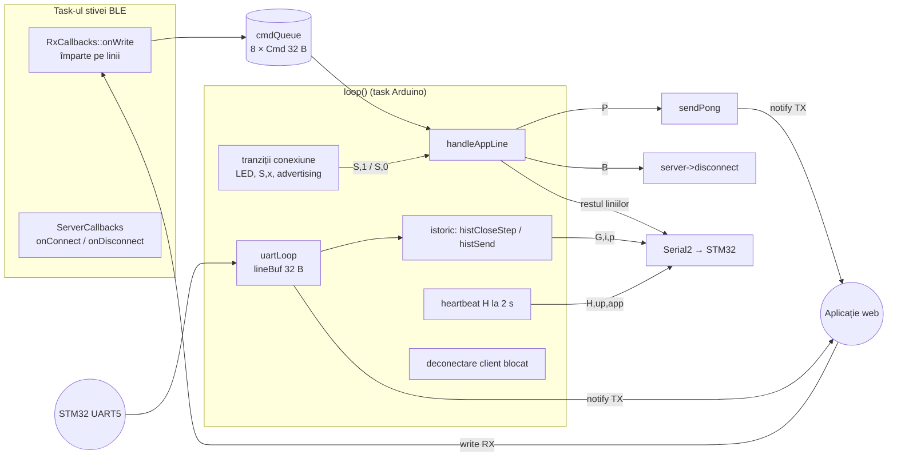
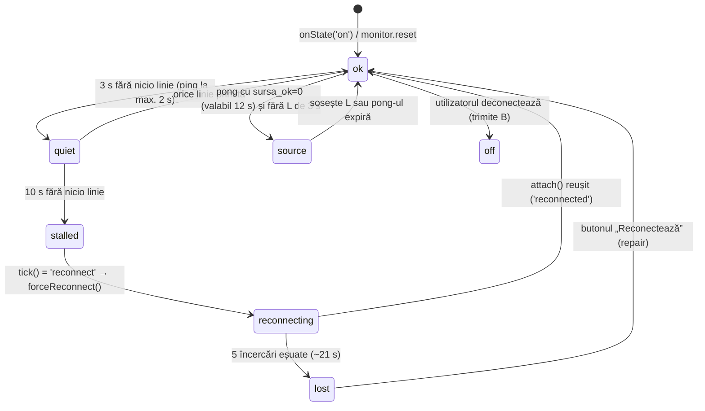

# Puntea ESP32 (UART ↔ BLE)

Vezi și: [index](README.md) · [firmware STM32](firmware-stm32.md) · [aplicația web](aplicatia-web.md) · [module web și cloud](module-web-si-cloud.md) · [protocol](../PROTOCOL.md) · [README](../README.md)

## 1. Rol și context

ESP32 e doar adaptorul Bluetooth al sticlei: primește liniile text ale STM32 pe `Serial2` (UART, 115200) și le trimite ca notificări BLE pe Nordic UART Service, iar liniile scrise de aplicația web le trimite înapoi pe UART. Nu citește niciun senzor și nu calculează mL. Pe lângă retransmisie, generează el însuși câteva mesaje: `S` și `H` spre STM32 (starea conexiunii, heartbeat), `P` (pong) spre aplicație și `G` (istoricul nivelului pentru graficul de pe LCD). Cu `MOCK_STM32 1` (implicit) înlocuiește complet STM32, ca BLE-ul și aplicația să poată fi testate fără placă.

## 2. Structura fișierelor

| Fișier | Responsabilitate |
|---|---|
| `esp32/SmartBottleBridge/SmartBottleBridge.ino` | Sketch-ul: server BLE NUS, advertising, coadă BLE → `loop()`, asamblarea liniilor UART, ping/pong, heartbeat `H`, deconectarea clienților blocați, istoricul `G`, LED, mod mock |
| `esp32/SmartBottleBridge/MockStm32.h` | Clasa `MockStm32`: simulează STM32 (citiri `L` la 1 s, înghițituri, reumpleri, răspuns la `C`/`R`). Compilată doar cu `MOCK_STM32 1` |

Numele folderului trebuie să rămână identic cu numele `.ino` (cerință Arduino, notată în `HANDOFF-ESP32.md`).

## 3. Arhitectură / flux



În mod mock, `Serial2` lipsește: `handleAppLine` trimite liniile la `MockStm32::handleCommand`, iar citirile mock trec prin `mockSink` → `notifyLine` (vezi §4.3).

### Secvența de la capăt la capăt (`MOCK_STM32 0`)

```mermaid
sequenceDiagram
  participant A as Aplicație (app.js)
  participant E as ESP32
  participant S as STM32
  A->>E: conectare GATT, startNotifications (TX)
  E->>E: onConnect: connected=true, appPings=false
  E->>S: S,1 (din loop, la tranziție); LED GPIO2 aprins
  Note over A: onState('on')
  A->>E: C,<gol>,<plin>
  E->>S: C,<gol>,<plin>
  S-->>E: A,C (sau E,C dacă gol == plin)
  E-->>A: notify A,C
  A->>E: R
  E->>S: R
  A->>E: T,<total>,<obiectiv>,<nr> · U,<min> · W,0..W,6
  E->>S: liniile, neschimbate (doar afișare pe LCD)
  loop la 1 s
    S-->>E: L,<raw>,<pct>,<stable>
    E-->>A: notify L,...
    E->>E: histAddLine (media pe 10 s)
    A->>E: M,<ml>,<cap> (max. 2/s la schimbare, repetat la 5 s)
    E->>S: M,...
  end
  loop la 2 s
    E->>S: H,<uptime_s>,<0|1|2>
  end
  loop la 10 s
    E->>S: G,0,<p> … G,59,<p>
  end
  loop la 5 s (sau după 3 s de liniște)
    A->>E: P
    E-->>A: P,<uptime_s>,<sursa_ok> (STM32 nu vede ping-ul)
  end
  A->>E: B (la deconectare / închiderea paginii)
  E->>E: server->disconnect(); apoi S,0 spre STM32, advertising din nou
```

### Sănătatea legăturii văzută de aplicație

Stările vin din `web/logic.js` → `LinkMonitor.health()`, acțiunile din `LinkMonitor.tick()` (apelat la 1 s de `heartbeat()` din `web/app.js`) și din `BleDevice.reconnect()`.



În `source` aplicația nu se reconectează: Bluetooth-ul merge, dar STM32 nu trimite (afișează „Fără date” și bannerul `sourceStall`).

## 4. Module în detaliu

### 4.1 `SmartBottleBridge.ino` — BLE

- **Serviciu**: Nordic UART Service, UUID-uri în `SERVICE_UUID`, `RX_UUID` (Write + Write Without Response, telefon → dispozitiv), `TX_UUID` (Notify, cu descriptor `BLE2902`/CCCD ca clientul să poată activa notificările). Tabelul e în [PROTOCOL.md](../PROTOCOL.md).
- **Advertising** (`setup()`): `BLEDevice::init(DEVICE_NAME)`, `adv->addServiceUUID(SERVICE_UUID)` (comentariu: necesar pentru filtrul Web Bluetooth — aplicația filtrează după serviciu sau nume `SmartBottle`), `setScanResponse(true)`, `BLEDevice::startAdvertising()`.
- **`ServerCallbacks`**: `onConnect` pune `connected = true`, `appPings = false`, `appBye = false`, `lastAppRx = millis()`. `onDisconnect` pune doar `connected = false`. Nimic altceva nu se face în callback, ca să nu blocheze stiva BLE.
- **`RxCallbacks::onWrite`**: ia valoarea scrisă (`std::string` pe core 2.x, `String` pe 3.x — ambele au `length()`/`c_str()`), actualizează `lastAppRx` și împarte conținutul pe `\n` (ignoră `\r`). Sfârșitul fiecărei scrieri e tratat ca sfârșit de linie (bucla merge până la `i <= n` cu `'\n'` implicit). Fiecare linie nevidă devine un `Cmd` pus în `cmdQueue` cu `xQueueSend(..., 0)` (fără așteptare). Caracterele peste `LINE_MAX - 1` = 31 sunt tăiate, linia rămâne.
- **`cmdQueue`**: `xQueueCreate(8, sizeof(Cmd))`, `struct Cmd { char text[LINE_MAX]; }`. Motiv (comentariu): scrierile BLE sosesc pe task-ul stivei BLE; procesarea (UART, notify, disconnect) se face în `loop()`. `loop()` golește coada la fiecare iterație (`xQueueReceive(..., 0)`), iar iterația durează ~2 ms (`delay(2)`).
- **`notifyLine(s, n)`**: dacă nu e client conectat, linia e aruncată; altfel `setValue` + `notify()`. Nu împarte pe MTU.

### 4.2 `SmartBottleBridge.ino` — logica punții

| Funcție | Ce face |
|---|---|
| `handleAppLine(line)` | `B` → `appBye = true`, `appPings = false`, `server->disconnect(server->getConnId())` (comentariu: altfel Windows poate ține legătura deschisă). `P` → `appPings = true`, `sendPong()`. Orice altă linie: `appBye = false`, apoi spre `Serial2` + `\n` și jurnal `[app] <linie>` pe USB (sau `mock.handleCommand` în mock). Nu filtrează: orice linie (inclusiv `S`, `H`, `G` scrise de un client) ajunge la STM32. E apelată și din `loop()` cu `"S,1"` / `"S,0"`. |
| `sendPong()` | Trimite `P,<millis()/1000>,<sursa_ok>`; `sursa_ok = 1` dacă `lastSourceRx != 0` și ultima linie de la sursă e mai nouă de `SOURCE_TIMEOUT_MS`. |
| `appState()` *(doar punte)* | 0 = fără client sau după `B`; 2 = aplicația a scris ceva în ultimele `APP_ALIVE_MS`; altfel 1 (client care nu răspunde). Valoarea merge în `H`. |
| `uartLoop()` *(doar punte)* | Asamblează linii din `Serial2` în `lineBuf[LINE_MAX]`. La `\n`: dacă linia nu e goală și nu a depășit, (1) dacă sursa tăcuse peste `SOURCE_TIMEOUT_MS`, cere retrimiterea istoricului (`histSendNow`, comentariu: STM32 probabil a repornit și a pierdut graficul); (2) `lastSourceRx = millis()`; (3) `histAddLine`; (4) notify spre aplicație și ecou pe USB. O linie de peste 31 de caractere e aruncată întreagă (`lineOverflow`). `\r` nu e eliminat (STM32 trimite doar `\n`). |
| `usbToUartLoop()` *(doar punte)* | Ce se tastează în Serial Monitor (USB) merge direct pe `Serial2`, fără `\r` — test fără telefon (ex. `R`, `C,100,3000`). |
| `loop()` | Ordinea pe iterație: golește `cmdQueue` → `mockLoop()` sau `uartLoop()` + `usbToUartLoop()` + heartbeat `H` + istoric → detectarea clientului blocat → tranziții de conexiune → `delay(2)`. |

**Heartbeat ESP32 → STM32**: la `HEARTBEAT_MS` (2 s), `H,<uptime_s>,<appState()>`. STM32 (`stm32/Core/Src/app.c` → `handle()`, `CMD_HEARTBEAT`) memorează uptime-ul, numără repornirile ESP32 dacă uptime-ul scade și apelează `set_app()` (LD3 aprins doar la starea 2). ESP32 e considerat căzut după `ESP_TIMEOUT_MS` = 5000 fără `H` (`stm32/Core/Inc/display.h`). `H` resincronizează starea și după un `S` pierdut.

**Client blocat**: dacă `connected && appPings && millis() - lastAppRx > APP_TIMEOUT_MS` (20 s), ESP32 închide conexiunea. Doar clienții care au trimis vreodată `P` sunt vizați, deci nRF Connect nu e deconectat.

**Tranziții de conexiune** (în `loop()`, nu în callback): dacă `connected` dar `server->getConnectedCount() == 0`, se forțează `connected = false` (comentariu: `onDisconnect` nu vine mereu, ex. pe Windows). La schimbarea lui `connected`: LED-ul `LED_PIN` urmează starea, se apelează `handleAppLine("S,1"|"S,0")`, iar la deconectare `delay(300)` și `BLEDevice::startAdvertising()`. La pornire, în modul punte, se trimite `S,0` spre STM32.

**Istoricul nivelului** (doar punte):

| Element | Detaliu |
|---|---|
| `hist[HIST_POINTS]` | `int8_t`, procent 0..100, `-1` = fără citiri; `[59]` = cel mai recent; inițializat cu `-1` (`memset` în `setup()`) |
| `histAddLine(line)` | Parsează `L,%ld,%ld,%ld`; ignoră alte linii și `pct` în afara 0..100. Adună în `minSumAll/minCntAll` și, dacă `stable`, în `minSumStable/minCntStable` |
| `histCloseStep()` | La `HIST_STEP_MS` (10 s): deplasează seria cu o poziție (`memmove`), noul punct = media citirilor stabile din pas, altfel media tuturor, altfel `-1`; resetează sumele; jurnal `[istoric] punct nou` |
| `histSend()` | Trimite `G,0,..` … `G,59,..` cu `delay(3)` între linii (comentariu: STM32 are un buffer de recepție de 128 de octeți — `RX_RING_SIZE` în `stm32/Core/Src/link.c`) |
| Când se trimite | După fiecare pas de 10 s și când STM32 revine după > 3 s de tăcere |

Istoricul e doar în RAM: supraviețuiește unei reporniri a STM32, nu și uneia a ESP32. STM32 îl primește prin `CMD_HISTORY` (`u.hist[i]`).

### 4.3 Modul mock (`MOCK_STM32 1`)

- `mockSink(s, n)`: actualizează `lastSourceRx` (deci pong-ul raportează `sursa_ok`), face notify și scrie linia pe USB.
- `mockLoop()`: comenzi pe Serial Monitor și butonul BOOT (`BOOT_BTN_PIN` = GPIO0, `INPUT_PULLUP`, activ pe 0, debounce 50 ms, la apăsare `startSip()`), apoi `mock.tick()`.
- În mock nu există `H`, `G`, `S,0` la pornire și nici `K`; liniile `M/T/U/W` sunt ignorate de `handleCommand`. `P` și `B` sunt tratate tot de puntea propriu-zisă.

| Tastă (USB, 115200) | Efect |
|---|---|
| `d` / BOOT | `startSip()`: înghițitură (dacă sticla e prezentă și nu e alta în curs) |
| `r` | `refill()`: nivel 95% |
| `l` | `toggleLift()`: sticla ridicată / pusă la loc |
| `a` | `toggleAuto()`: înghițituri automate |
| `f` | `toggleFreeze()`: „STM32 blocat” — nu mai trimite și nu mai răspunde la comenzi |
| `?` | ajutor |

### 4.4 `MockStm32.h` — modelul sticlei simulate

| Membru | Rol |
|---|---|
| `RAW_EMPTY = 800`, `RAW_FULL = 3000` | Calibrarea implicită, aceeași ca Demo-ul din aplicația web (ADC 12 biți) |
| `STABLE_N = 5`, `STABLE_TOL = 15` | Fereastra și toleranța de stabilitate (comentariu: ca `STABLE_COUNT` / `STABLE_TOLERANCE` din `app_config.h`) |
| `begin()` | `randomSeed(esp_random())`, nivel 80%, prima înghițitură automată la 8 s |
| `tick()` | Dacă nu e înghețat: pornește înghițituri automate la 20–40 s (`nextAutoSip_`) și emite o citire pe secundă |
| `handleCommand(line)` | `C,e,f` cu `e != f` → salvează și răspunde `A,C`, altfel `E,C`; `R` → citire imediată; `S,x` → doar jurnal `[mock] telefon conectat/deconectat` |
| `emitReading()` | Zgomot ±3 unități în repaus; în timpul înghițiturii (`sipLeft_` = 3 citiri) zgomot ±200 (sticla înclinată), apoi nivelul scade cu 6–14%; sub 12% se reumple automat. Sticla ridicată → `RAW_EMPTY - 400` (aplicația o vede ca lipsă). `raw` limitat la 0..4095; `stable` = ultimele 5 citiri în ±15 (max − min ≤ 15); `pct = (raw − gol)·100/(plin − gol)`, limitat la 0..100 |
| `send(s)` | Adaugă `\n` și apelează `sink_` |

Ca la STM32, sticla simulată pornește cu ultimele citiri instabile până se umple fereastra (`histCount_ < STABLE_N`).

## 5. Configurare

| `#define` | Implicit | Efect |
|---|---|---|
| `MOCK_STM32` | `1` (protejat cu `#ifndef`, deci se poate da `-DMOCK_STM32=0`) | 1 = simulează STM32; 0 = punte reală pe `Serial2` |
| `DEVICE_NAME` | `"SmartBottle"` | Numele BLE (aplicația filtrează după el sau după serviciu) |
| `SERVICE_UUID` / `RX_UUID` / `TX_UUID` | `6E400001/2/3-B5A3-F393-E0A9-E50E24DCCA9E` | Nordic UART Service |
| `UART_RX_PIN` | `16` | RX2, de la STM32 PC12 (UART5 TX) |
| `UART_TX_PIN` | `17` | TX2, spre STM32 PD2 (UART5 RX) |
| `UART_BAUD` | `115200` | `Serial2`, 8N1 (USB debug tot 115200) |
| `LED_PIN` | `2` | LED albastru de pe DevKit: aprins cât e un client BLE conectat |
| `LINE_MAX` | `32` | Lungimea maximă a unei linii cu terminator (UART, coadă, pong) |
| `BOOT_BTN_PIN` | `0` | Butonul BOOT; în mock = înghițitură |
| `SOURCE_TIMEOUT_MS` | `3000` | Fereastra pentru `sursa_ok` și pragul de „STM32 a tăcut” (retrimite istoricul) |
| `HEARTBEAT_MS` | `2000` | Perioada `H` spre STM32 |
| `APP_ALIVE_MS` | `12000` | Fără scrieri de la aplicație atâta timp → `H,..,1` |
| `APP_TIMEOUT_MS` | `20000` | Client cu ping care tace atâta timp → deconectat |
| `HIST_POINTS` | `60` | Puncte de istoric (ca `HIST_POINTS` din `stm32/Core/Inc/protocol.h`) |
| `HIST_STEP_MS` | `10000` | Durata unui punct de istoric |

Alte valori fixe din cod: coada `8` elemente, debounce BOOT `50` ms, `delay(3)` între liniile `G`, `delay(300)` înainte de reluarea advertising-ului, `delay(2)` la sfârșitul `loop()`.

Constantele pereche din aplicație (`web/logic.js` → `HEARTBEAT`): `pingEvery` 5000, `quietAfter` 3000, `pingGap` 2000, `stallAfter` 10000, `sourceStale` 12000; `RECONNECT_DELAYS` = 500, 1500, 3000, 6000, 10000 ms în `web/app.js`.

## 6. Build / rulare / testare

**Arduino IDE** (`../README.md`): deschide `esp32/SmartBottleBridge/SmartBottleBridge.ino`, placa **ESP32 Dev Module**, încarcă. Sketch-ul e scris pentru core ESP32 2.x și 3.x. Pentru puntea reală pune `#define MOCK_STM32 0`.

**arduino-cli** (din rădăcina repo-ului, după `HANDOFF-ESP32.md`):

```
arduino-cli config add board_manager.additional_urls https://espressif.github.io/arduino-esp32/package_esp32_index.json
arduino-cli core update-index
arduino-cli core install esp32:esp32
arduino-cli compile --fqbn esp32:esp32:esp32 smart-bottle/esp32/SmartBottleBridge
arduino-cli compile --fqbn esp32:esp32:esp32 --build-property "compiler.cpp.extra_flags=-DMOCK_STM32=0" smart-bottle/esp32/SmartBottleBridge
arduino-cli compile --upload --fqbn esp32:esp32:esp32 -p COMx smart-bottle/esp32/SmartBottleBridge
arduino-cli monitor -p COMx -c baudrate=115200
```

- Dacă biblioteca BLE nu încape: `--board-options PartitionScheme=huge_app`.
- Folosește `compile --upload`, nu `upload` simplu: acesta ar scrie ultimul build din cache (posibil cel cu `MOCK_STM32=0`).
- „Failed to connect” la upload: ține apăsat BOOT când pornește încărcarea.
- `HANDOFF-ESP32.md` notează că sketch-ul a fost verificat doar sintactic cu headere stub; compilarea cu toolchain-ul real și scrierea pe placă sunt (neverificat).

**Teste manuale** (nu există teste automate pentru sketch; `tests/` acoperă protocolul STM32 și logica aplicației, nu ESP32):
- Mock: în monitor apare `SmartBottle MOCK pornit (fără STM32). Comenzi: d r l a ?`; conectează aplicația, `d`/BOOT → aplicația înregistrează o înghițitură.
- Heartbeat: `f` → în ~5 s aplicația arată „Fără date” fără să se reconecteze; `f` din nou reia. Reset pe EN → aplicația arată „Se reconectează…” și revine singură (~20 s).
- Fără aplicație: nRF Connect, conectare la `SmartBottle`, notificări pe TX → `L,...` la fiecare secundă.
- Punte reală fără telefon: comenzi tastate în monitor (`R`, `C,100,3000`) ajung la STM32 prin `usbToUartLoop()`; liniile STM32 apar pe USB.

## 7. Cum extinzi

**Mesaj nou aplicație → STM32** (ex. `X,<n>`): ESP32 nu trebuie modificat — orice linie în afară de `P` și `B` e retransmisă. Pași: adaugă rândul în `../PROTOCOL.md`; parsare în `stm32/Core/Src/protocol.c` → `proto_parse()` (+ tip nou în `protocol.h`); tratare în `stm32/Core/Src/app.c` → `handle()`; trimitere din `web/app.js` prin `sendToDevice()`. Ține linia ≤ 20 octeți cu `\n` (vezi §8). Dacă vrei și în mock, adaugă un caz în `MockStm32::handleCommand`.

**Mesaj nou STM32 → aplicație**: la fel, ESP32 îl transmite neschimbat (≤ 31 caractere); parsarea în `web/logic.js` → `parseMessage()`, tratarea în `web/app.js` → `onLine()`. Pentru mock, emite-l din `MockStm32` prin `send()`.

**Mesaj generat de ESP32** (ca `P`/`B`): ramură nouă în `handleAppLine()` înainte de retransmisie (aplicație → ESP32) sau în `loop()` cu `Serial2.write` (ESP32 → STM32); documentează-l în secțiunea „ESP32 → STM32 (intern)” din `../PROTOCOL.md`.

**Alt pin/alt baud**: `UART_RX_PIN`, `UART_TX_PIN`, `UART_BAUD` aici și UART5 pe STM32 (`stm32f4xx_hal_msp.c`, vezi `../README.md`).

**Alt orizont de istoric**: `HIST_POINTS` / `HIST_STEP_MS` aici și `HIST_POINTS` din `stm32/Core/Inc/protocol.h` (validat în `proto_parse()` și folosit la desen în `display.c`) trebuie să rămână egale.

## 8. Limitări cunoscute și riscuri

- **Linii > 20 octeți pe BLE**: aplicația (`BleDevice.send`) taie scrierile în bucăți de 20 de octeți, iar `RxCallbacks::onWrite` tratează sfârșitul fiecărei scrieri ca sfârșit de linie → o linie mai lungă ar ajunge la STM32 ca două linii invalide. În sens invers, `notifyLine` trimite până la 31 de octeți fără împărțire, dar peste MTU-ul implicit (20 octeți utili) notificarea poate fi trunchiată (neverificat). Mesajele actuale încap.
- **Coadă plină**: `xQueueSend(..., 0)` pierde liniile fără avertisment dacă sunt > 8 în așteptare. La conectare aplicația trimite ~11 linii (`C`, `R`, `T`, `U`, `W`×7), dar serializat; `loop()` golește coada la ~2 ms, deci în practică nu se umple — riscul apare doar dacă `loop()` e blocat (ex. `histSend()` ≈ 60 × 3 ms ≈ 180 ms, `delay(300)` la deconectare).
- **Trunchiere vs. aruncare**: linia prea lungă de la aplicație e trunchiată la 31 de caractere (și trimisă), cea de la STM32 e aruncată întreagă.
- **Fără filtrare**: un client poate trimite `S`, `H` sau `G` direct la STM32.
- **Un singur client**: `getConnId()` și `appState()` presupun o singură conexiune; advertising-ul se reia doar după deconectare.
- **`histSend()` blocant** la fiecare 10 s și fără verificarea faptului că STM32 a consumat liniile; bufferul de 128 octeți al STM32 se bazează pe pauza de 3 ms.
- **Istoricul se pierde** la repornirea ESP32; în mock nu există istoric `G`.
- Variabilele `connected`, `lastAppRx`, `appPings`, `appBye` sunt partajate între task-ul BLE și `loop()` doar prin `volatile`, fără secțiune critică (scrieri de 32 de biți, practic atomice).

## Neconcordanțe găsite între cod și documentație

- `HANDOFF-ESP32.md` pasul 6: „liniile `L,...` apar pe USB doar cât e un telefon conectat”; `mockSink()` le scrie pe USB mereu (doar notificarea BLE depinde de conexiune).
- Mesajul de pornire al mock-ului listează `d r l a ?`, fără `f`, deși `f` există (apare în ajutorul `?`).
- Comentariul lui `APP_ALIVE_MS` spune „aplicația scrie cel puțin la 5 s”: corect pentru `pingEvery`, dar în stare `quiet` ping-ul vine la 2 s — fără impact.
