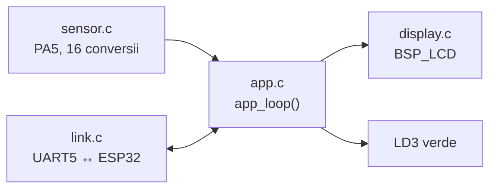

# Smart Bottle pe șablonul de laborator Template_GPIO (varianta simplificată)

Firmware Smart Bottle redus la esențial, în structura șablonului de laborator *Template_MC2025 /
Template_GPIO* (proiect CubeMX + Keil µVision pentru STM32F429I-DISC1). Folderul e de sine stătător:
conține driverele și se poate copia sau arhiva separat de restul repo-ului.

Ce face placa:
- citește senzorul de nivel (PA5) o dată pe secundă și calculează procentul după calibrare;
- trimite citirea spre ESP32 (`L,brut,procent,stabil`) și primește de la aplicația web calibrarea (`C`),
  cererea de citire (`R`), volumul în mL (`M`) și starea legăturii (`H`, `S`); restul mesajelor sunt ignorate
  (formatul e în [`../PROTOCOL.md`](../PROTOCOL.md));
- afișează pe LCD sticla, procentul, mL-ul, valoarea brută, stabilitatea și dacă aplicația e conectată;
- aprinde LED-ul verde (LD3) cât timp aplicația e activă; LED-ul roșu (LD4) clipește doar la eroare fatală;
- scrie pe portul serial USB fiecare mesaj trimis și primit.

Aplicația web și ESP32 funcționează la fel ca cu firmware-ul complet din `../stm32/`.

## Codul

| Fișier | Rol | Linii |
|---|---|---|
| `Src/main.c` | Generat de CubeMX (ceas 180 MHz, GPIO, ADC1, UART5, USART1); cheamă `app_init()` și `app_loop()` | — |
| `Src/app.c` | Bucla: o citire pe secundă, mesajele primite, LED-ul, LCD-ul | 104 |
| `Src/sensor.c` | Citirea ADC cu alimentare comutată pe PE4, media fără extreme, stabilitatea, procentul | 64 |
| `Src/link.c` | UART5: primire pe întreruperi în buffer circular, compunerea liniilor, trimiterea | 93 |
| `Src/display.c` | LCD-ul cu funcțiile `BSP_LCD_*` și fonturile BSP | 105 |
| `Inc/*.h` | `app_config.h` cu toate constantele, plus interfețele modulelor | 114 |

În total ~480 de linii de cod propriu, față de ~2 200 (plus 1 500 de linii de fonturi generate) în `../stm32/Core`.

## Deschidere și scriere pe placă

1. Keil MDK cu **Arm Compiler 6.22** și pack-ul `Keil::STM32F4xx_DFP` (proiectul e salvat cu 2.17.1, ca șablonul).
   Imaginea are 31,3 KB compilată cu GCC (Arm Compiler 6 cu `-Oz` și MicroLIB dă de obicei mai puțin), deci ar
   trebui să încapă în limita de 32 KB a licenței gratuite MDK-Lite.
2. Deschide `MDK-ARM/Template_GPIO.uvprojx`.
3. **F7** compilează, **F8** scrie pe placă prin ST-LINK-ul de pe placă și pornește programul.
4. Jurnalul: terminal serial pe portul COM „STMicroelectronics STLink Virtual COM Port”, **115200** 8N1.
   La pornire apare `[boot] Smart Bottle (Template_GPIO), 180 MHz`, apoi `[tx] L,...` în fiecare secundă.

Cablajul: senzorul `+` la PE4, `S` la PA5, `−` la GND; ESP32 cu PC12 → GPIO16, PD2 ← GPIO17 și GND comun
(detalii în [`../README.md`](../README.md#cablaj)).

## Ce s-a schimbat față de șablon

| Zonă | Șablon | Aici |
|---|---|---|
| Compilator | Arm Compiler 5.06 | Arm Compiler 6.22, C99, `-Oz`, MicroLIB |
| Ceas | HSI, 25 MHz | HSE 8 MHz → PLL 180 MHz (Scale 1 + over-drive, 5 stări de așteptare Flash) |
| Periferice (.ioc) | GPIO (LD3, LD4, USER), USART1 9600 | + ADC1 IN5 pe PA5, UART5 115200 pe PC12/PD2, PE4 alimentarea senzorului, USART1 115200 |
| NVIC | toate pe prioritatea 0 | UART5 și USART1 pe 5, SysTick pe 15 |
| Stiva | 0x400 | 0x1000 (în `.ioc` și în `MDK-ARM/startup_stm32f429xx.s`) |
| `main.c` | clipește LED-urile, `printf` pe USART1 | inițializările de mai sus, apoi `app_init()` / `app_loop()` în `USER CODE` |
| Drivere | HAL minimal + CMSIS complet (~90 MB cu DSP/NN/RTOS) | HAL 1.8.5 (aceeași versiune) cu ADC, LTDC, DMA2D, SDRAM/FMC, SPI, I2C pentru LCD, BSP-ul LCD-ului, fonturile; CMSIS doar `Include` |

LTDC, DMA2D, SDRAM, SPI și I2C le folosește doar BSP-ul LCD-ului, care le inițializează singur. De aceea nu
sunt în `.ioc`, ci activate din definițiile proiectului Keil (`HAL_LTDC_MODULE_ENABLED` etc.), ca să nu le
dezactiveze o regenerare a lui `stm32f4xx_hal_conf.h`.

## Față de firmware-ul complet (`../stm32/`)

Lipsesc intenționat: meniul tactil cu patru pagini și grafica proprie (fonturi cu diacritice, colțuri netezite),
graficul de istoric și statisticile zilei, calibrarea de pe ecranul tactil, senzorul simulat, varianta cu
HX711 și varianta cu protocolul pe USB. Textele de pe LCD sunt fără diacritice (fonturile BSP au doar ASCII).

## Regenerarea din CubeMX

Codul nostru stă doar în `USER CODE` și în fișierele proprii (`app.c`, `sensor.c`, `link.c`, `display.c`), deci
o regenerare ar trebui să-l păstreze. `.ioc`-ul a fost editat de mână: la prima deschidere în CubeMX verifică
pinii (PA5, PC12, PD2, PE4) și ceasul de 180 MHz. Dacă după regenerare lipsesc din proiect fișierele HAL pentru
LTDC, DMA2D, SDRAM (`stm32f4xx_ll_fmc.c`), SPI sau I2C, adaugă-le înapoi în grupul `Drivers/STM32F4xx_HAL_Driver`.

## Verificat

Fișierele, definițiile și căile din `Template_GPIO.uvprojx` compilate cu GCC (C99, `-Wall -Wextra`, fără
avertismente în codul aplicației): 31,3 KB flash. Pe placă: pornire la 180 MHz, citiri trimise la fiecare
secundă, mesaje primite de la ESP32 și aplicație, LCD-ul (sticla, procentul, mL-ul, starea legăturii) și LED-ul
verde. Compilarea cu Arm Compiler 6 în Keil și deschiderea `.ioc`-ului în CubeMX nu au putut fi încercate pe
calculatorul pe care s-a făcut varianta.
